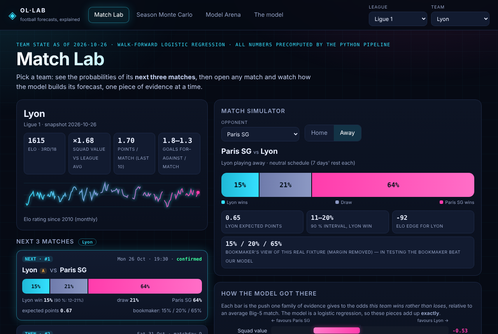
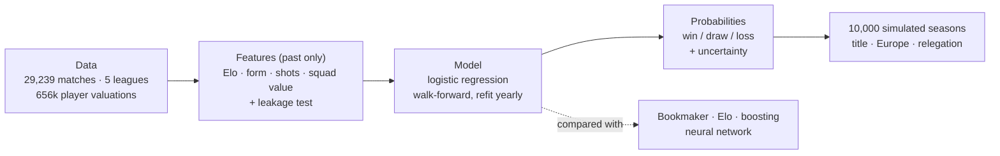
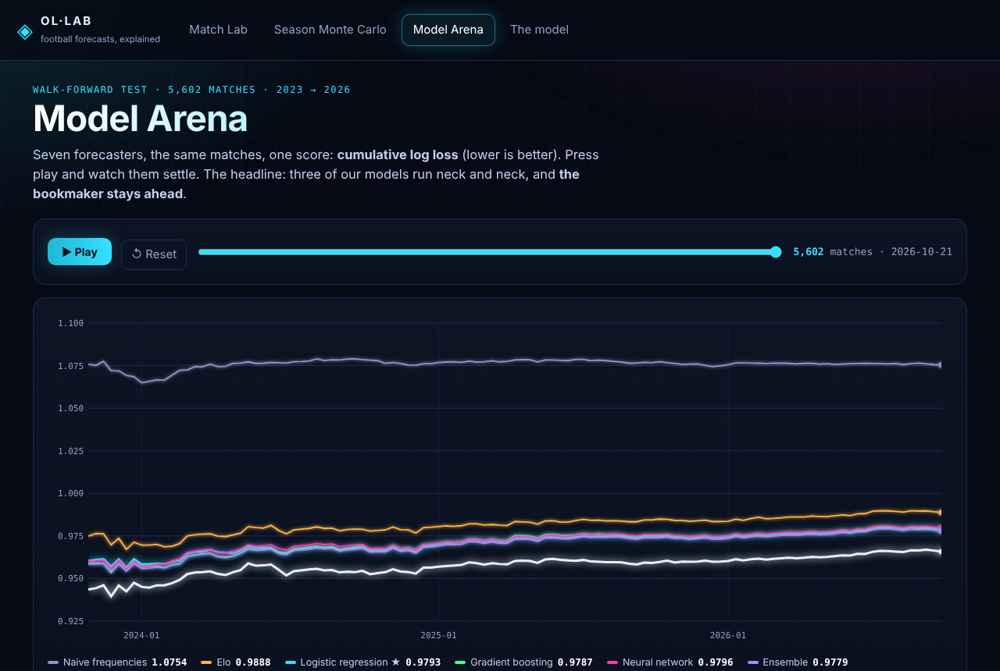
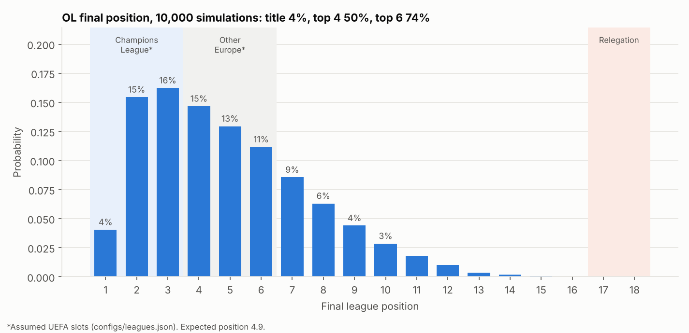
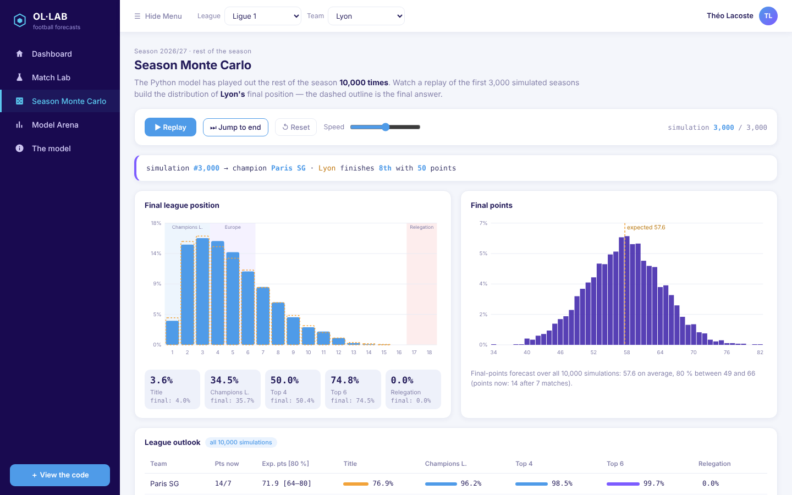

# OL·LAB — Can machine learning predict Olympique Lyonnais?

*A leakage-free, walk-forward study of football match probabilities, season simulation and market efficiency in the five major European leagues, with Olympique Lyonnais (OL) as the case study.*

[](.github/workflows/tests.yml)
 



## In 30 seconds

| | |
|---|---|
| **Question** | Do ML models give better football-match probabilities than Elo ratings or the betting market? What do they say about OL? |
| **Chosen model** | **Multinomial logistic regression** on 100 inputs (Elo, squad market value, recent form, shots, schedule), re-fitted every season. Boosting, random forest, SVM and neural networks were tested: **none beats it significantly**, so the simplest one is kept. |
| **Answer** | Team strength (Elo, squad value) explains almost everything that is predictable. The probabilities are **well calibrated**, but the **bookmaker is better** (log loss 0.966 vs 0.979) and adding our models to its prices adds **nothing**. |
| **For OL** | Ligue 1 2026/27: **57.6 expected points** (80 % interval 49–66), **50 % chance of the top 4**, 4 % of the title. Next: Paris SG – Lyon 15 % / 21 % / 64 % (win / draw / loss). |
| **Rigour** | Features built only from the past (an automated test proves it), temporal validation, confidence intervals on every comparison, uncertainty on every forecast, negative results reported as such. |

## Try it

| | How |
|---|---|
| 🌐 **Interactive site** (futuristic, no install) | open **`site/ol-lab-standalone.html`** (after `make site`), or `site/index.html` from a clone. Published on GitHub Pages once merged to `main` — see [Website](#website). |
| 📊 **Streamlit dashboard** | `make dashboard` |
| 📄 **14-page report** | [`reports/final_report.pdf`](reports/final_report.pdf) |
| 📓 **Notebooks** | [`notebooks/`](notebooks/) (executed, 01 → 08) |

## How it works



**Glossary.** *Elo*: a strength score updated after every match. *Log loss*: penalises confident wrong forecasts (lower is better; 1.075 = ignoring team quality, 0.966 = bookmaker). *Calibration*: a "70 %" forecast should come true ~70 % of the time. *Walk-forward*: train on the past, predict the next season, repeat. *Leakage*: using information from after the match. *Monte Carlo*: replay the season thousands of times with the model's probabilities.

## Results (test seasons 2023 → 2026, 5,602 matches)

| Model | Accuracy | **Log loss** [95 % CI] | Brier | Calibration error |
|---|---|---|---|---|
| Baseline (class frequencies) | 43.2 % | 1.0754 [1.069, 1.082] | 0.651 | 0.012 |
| Elo | 52.5 % | 0.9888 [0.979, 0.999] | 0.590 | 0.017 |
| Poisson goals | 52.0 % | 0.9902 [0.980, 1.001] | 0.591 | 0.022 |
| **Logistic regression (chosen)** | 53.3 % | **0.9793** [0.969, 0.990] | 0.583 | 0.016 |
| Gradient boosting | 53.0 % | 0.9787 [0.968, 0.989] | 0.583 | 0.020 |
| Neural network (MLP) | 53.0 % | 0.9796 [0.969, 0.990] | 0.583 | 0.021 |
| Ensemble of the three | 53.0 % | 0.9779 [0.967, 0.988] | 0.582 | 0.017 |
| *Bookmaker (Bet365)* | *54.0 %* | *0.9658* [0.955, 0.977] | *0.574* | *0.022* |



- **Logistic regression beats Elo** (−0.0095, CI [−0.0135, −0.0056]); **boosting and the neural network do not beat it** (−0.0007 and +0.0003, CIs contain 0); **the bookmaker beats everyone** (+0.0135, CI [+0.0094, +0.0175]).
- **Draws are essentially unpredictable** (the draw is the most likely outcome in 6 of 5,602 matches), so accuracy is a weak summary; probabilistic scores are the right yardstick.
- **What explains results?** Elo and squad market value dominate; recent form and shots add a little; rest, league position and venue form add nothing ([interpretation](docs/phase7_interpretability.md)).
- **Does updating the weights as results arrive help?** No measurable gain: the adaptivity already lives in the Elo and form features.
- **Models vs market (finance extension).** Pooling model and market probabilities, the optimal weight on our model is **0.00**: the market already contains everything the models know (average margin 5.5 %). Purely an efficiency test — no betting strategy is built.
- **Ablation.** Elo alone 0.9957 → + form 0.9931 → + shots 0.9887 → + table/fatigue 0.9890 (no gain) → + squad value 0.9870.

Full discussion: [`docs/final_evaluation.md`](docs/final_evaluation.md).

## OL predictions and season simulation (state: 26 October 2026)

OL is **3rd in Ligue 1 by Elo**, 5th for form and squad value (defence 10th). Forecasts carry two kinds of uncertainty: model (100 bootstrap refits) and team strength (Elo ±60 points). The Monte Carlo simulator was **backtested** on 2023–2025: error on final points **6.4 vs 8.9** for the naive reference, calibrated probabilities — but its "80 %" intervals covered only 72 %, so read them as lower bounds.



| Ligue 1 2026/27 | Expected points [80 %] | Title | Top 4 | Top 6 | Relegation |
|---|---|---|---|---|---|
| Paris SG | 71.9 [64–80] | 76.9 % | 98.5 % | 99.7 % | 0 % |
| **Lyon** | **57.6 [49–66]** | **4.0 %** | **50.4 %** | **74.5 %** | **< 0.1 %** |

European slots are assumptions (`configs/leagues.json`). Details: [`docs/phase8_ol_predictions.md`](docs/phase8_ol_predictions.md), [`docs/phase9_season_simulation.md`](docs/phase9_season_simulation.md).

## Website



A static site (HTML + JavaScript, no server, no dependency) with four sections:

1. **Match Lab** — pick a team: probabilities of its **next three matches**, a match simulator, and an animated decomposition showing how Elo, squad value, form… add up to the forecast (exact for a logistic regression).
2. **Season Monte Carlo** — replay of simulated seasons building the distribution of the team's final position and points.
3. **Model Arena** — animated race of seven forecasters over the 5,602 test matches.
4. **The model** — what is running, why it was chosen, what neural networks would look like, glossary and limits.

*About "next three matches":* the odds source lists only the **next round**. For **Ligue 1** the following matches come from the published calendar (dates can change); for the **other four leagues** matches 2–3 are not collected, so you choose the opponent. A match already played before the snapshot is flagged as such. All numbers are precomputed by Python (`make site`); the browser does no machine learning.

**Publishing:** merge to `main`, then *Settings → Pages → Source: GitHub Actions*; `.github/workflows/pages.yml` deploys `site/`.

## Method, in brief

- **Data**: [football-data.co.uk](https://football-data.co.uk/data.php) results, shots and odds (private, non-commercial use; raw files are **not** redistributed), the CC0 [Transfermarkt dataset](https://github.com/dcaribou/transfermarkt-datasets) for squad values, a public Ligue 1 calendar for display. Rejected: FBref advanced data (removed Jan 2026), Understat (`robots.txt` forbids it), ClubElo (unreachable). All terms, limits and biases: [`docs/data_sources.md`](docs/data_sources.md).
- **No leakage**: rolling windows shifted by one match; Elo stored before its update; squad values dated before the snapshot; bookmaker odds never a feature. An **automated perturbation test** replaces every result from a cutoff onward by random values and requires earlier features to be bit-for-bit identical (it fails on two deliberately injected bugs); another test shows features of *future* fixtures equal the training features exactly. Details: [`docs/features.md`](docs/features.md).
- **Two data lessons**: the "xG proxy" is just `0.287 × shots on target`; variables counting matches-seen-so-far are a calendar clock — removed from the final feature set.
- **Validation**: train 2011–2020 → validation 2021–22 → test 2023–2026 used once, walk-forward by season. Primary metric log loss (a proper scoring rule); differences tested by a paired block bootstrap (calendar weeks).
- **Models**: scikit-learn only (no Dropout/BatchNorm: replaced by L2, few epochs, seed averaging). LSTM/GRU deliberately not built.

## Limitations

No injuries, line-ups or coaching information (the likely source of the gap to the bookmaker); no real xG; squad values are a crowd-sourced snapshot (June 2026) with 13 unmatched clubs; Bet365 pre-match prices with simple margin removal; few validation windows; SVM under-tuned; simulation intervals too narrow; UEFA slots assumed; team state excludes 8 results of 23–25 October not yet in the data source; football-data.co.uk limits use to private, non-commercial purposes.

## Reproducibility

```bash
git clone https://github.com/lacostetheo/ML-PREDICTION-OLYMPIQUE-LYONNAIS && cd ML-PREDICTION-OLYMPIQUE-LYONNAIS
git checkout claude/olympique-lyonnais-ml-prediction-guhzl2     # until merged to main
pip install -r requirements.txt        # Python 3.12; or: conda env create -f environment.yml
make pipeline     # data → features → simulator backtest → OL predictions → simulations (~25 min, needs internet)
make site         # export site data + build site/ol-lab-standalone.html
make dashboard    # Streamlit app
make all          # every experiment (~1 h)        make test   # 22 tests incl. the leakage test
```

Seeds are fixed and raw data are downloaded (not committed). Because the current season and fixture list refresh on each run, re-running later includes newer matches; committed tables correspond to the state of **26 October 2026**. Per-phase reports are in [`docs/`](docs/), every number in `reports/tables/`.

```
├── site/                 # website (index.html, app.js, style.css, data.js)
├── app/streamlit_app.py  # dashboard
├── src/olpred/           # data/ features/ models/ evaluation/ predict/ viz/ + run_*.py entry points
├── notebooks/            # 01 exploration … 08 final evaluation (executed)
├── docs/                 # data sources, features, one report per phase
├── reports/              # final_report.pdf/.md, tables/, figures/
├── configs/leagues.json  # league slots (assumptions, flagged)
└── tests/                # leakage, metrics, online learning, dashboard, site data
```

---

*Author: Théo Lacoste — EDHEC Business School (BBA). Academic project; **not betting advice**. Code under the MIT licence; data subject to their own terms (see `docs/data_sources.md`).*
