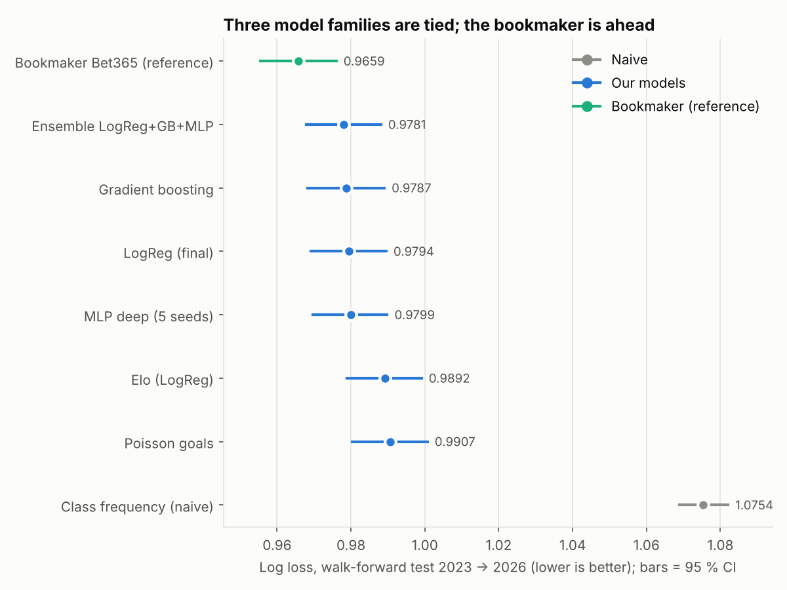
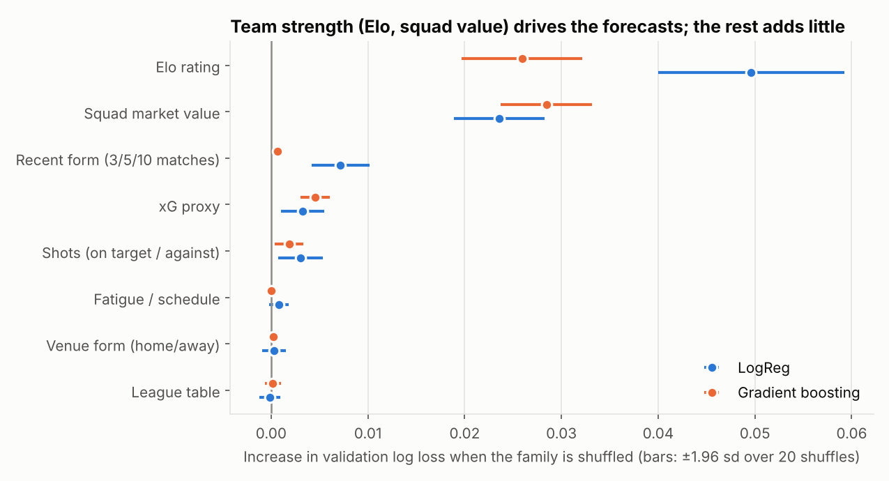
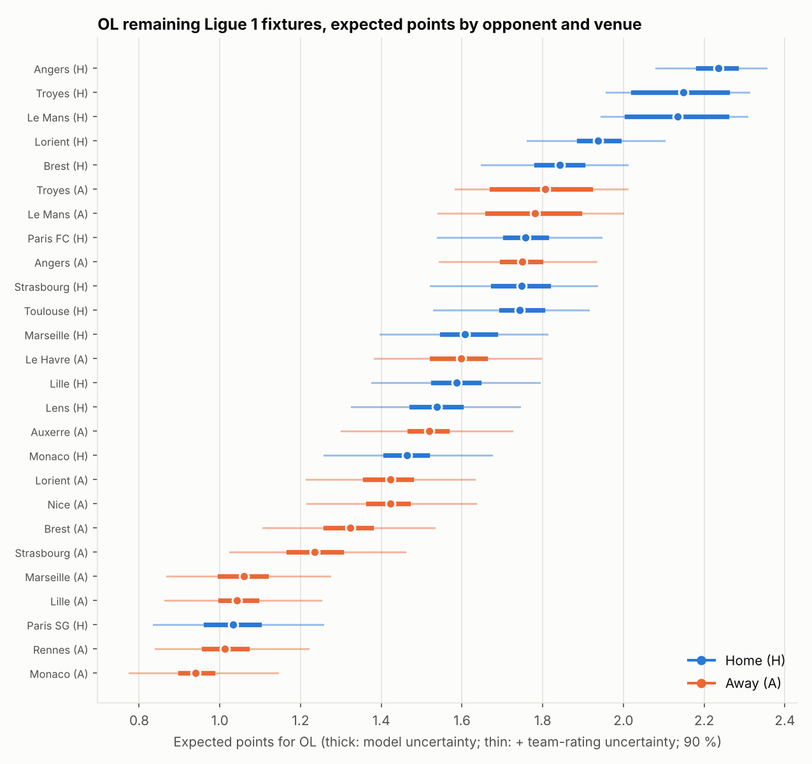
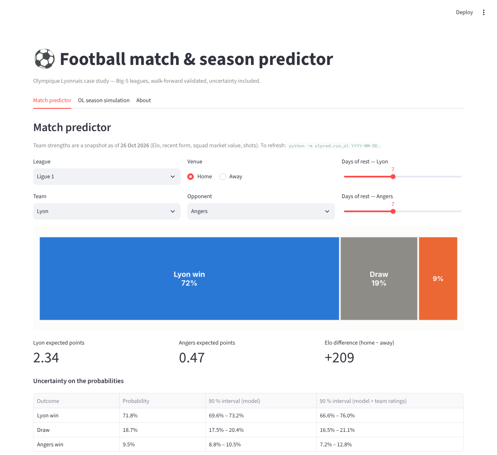

# Can Machine Learning Predict the Performance of Olympique Lyonnais?

*A leakage-free, walk-forward study of match probabilities, season simulation and market efficiency in the five major European leagues — with Olympique Lyonnais (OL) as the case study.*

[](.github/workflows/tests.yml)
 

**TL;DR** — On 29,239 matches (2010/11 → Oct 2026) and a walk-forward test of 5,602 matches (2023 → 2026):
team strength (Elo, squad market value) explains almost everything that is predictable; a regularised **logistic
regression is statistically indistinguishable from boosting and neural networks**; the probabilities are **well calibrated**;
the **bookmaker is better** (log loss 0.966 vs 0.979) and adding our models to its prices adds **nothing**. A backtested Monte Carlo
simulator gives OL **57.6 expected points (80 % interval 49–66), 50 % chance of the top four, 4 % of the title** in Ligue 1 2026/27.
Negative results are reported as such.

📄 **[Final report (14 pages, PDF)](reports/final_report.pdf)** · [Markdown](reports/final_report.md) · 📓 [Notebooks](notebooks/) · 🖥️ [Dashboard](#dashboard)

---

## 1. Project overview

The repository takes a question that is easy to answer badly — "predict a football team's results" — and treats it as
quantitative research: leakage-free features, temporal validation, proper scoring rules, confidence intervals for every
claimed improvement, uncertainty at every level, and a comparison with a liquid market.

## 2. Research question

> *Do machine-learning models produce better-calibrated and more accurate match-outcome probabilities than simple references
> (Elo, bookmaker-implied probabilities) — and what do they say about OL?*

**Why not "a neural network that predicts OL's ranking"?** OL plays ~35 league matches a year: far too few to train anything; a ranking
is one observation per team-season; and networks rarely beat simpler models on tabular data of this size. So the models are trained on **all
five leagues** and OL is the application. Targets: win/draw/loss probabilities (main), expected points (derived), and season outcomes by
**Monte Carlo simulation** of match probabilities. The "player contribution" target was dropped (a causal question, too little data) and replaced by an ablation of data categories.

## 3. Why this project?

Football forecasting is the setting where the margin between a naive and an excellent forecast is smallest, which makes the *method* matter:
the same questions arise in quantitative finance — probabilistic forecasting, proper scoring rules, calibration, backtesting without look-ahead,
non-stationarity, multiple-testing and over-fitted backtests, Monte Carlo risk simulation, and market efficiency.

## 4. Dataset

| Source | Content | Notes |
|---|---|---|
| [football-data.co.uk](https://football-data.co.uk/data.php) | Results, shots, odds; 5 leagues, 2010/11 → 2026 (29,239 matches) | Free for **private, non-commercial** use; raw data are **not redistributed** |
| [Transfermarkt dataset](https://github.com/dcaribou/transfermarkt-datasets) (CC0) | 656k player market valuations | Pipeline stopped in July 2026 |
| Computed here | Elo ratings; shot-based "xG proxy" | |

Rejected: FBref advanced data (removed by its provider, Jan 2026), Understat (`robots.txt` forbids automation), ClubElo (unreachable), and any source for injuries/line-ups/wages
(none clean and free). Every source's URL, period, variables, limits, biases and terms are in [`docs/data_sources.md`](docs/data_sources.md).

## 5. Methodology

Chronological split: **train 2011–2020 → validation 2021–22 → test 2023–2026**, with the test seasons used once, via **walk-forward** (refit each season on all earlier data,
hyper-parameters frozen). Primary metric: **log loss** (a proper scoring rule); also Brier, RPS, accuracy, F1, ROC-AUC, confusion matrix and calibration. Differences between models are tested with a
**paired block bootstrap** (calendar weeks resampled). Hyper-parameters come only from time-ordered cross-validation inside the training seasons.

## 6. Feature engineering (and how leakage is avoided)

Elo (home-made), rolling form (3/5/10 matches), venue form, league table, rest/congestion, squad market value relative to the league, shots — each for home, away and the difference
([`docs/features.md`](docs/features.md)). Every feature is built from matches **strictly before** the one predicted:

- rolling windows are shifted by one match; missing history is filled with the league mean over *earlier* dates; Elo stores the rating *before* the update; squad values use valuations dated *before* the snapshot; **bookmaker odds are never features**;
- an **automated perturbation test** replaces every result from a cutoff onward with random values, re-runs the pipeline, and requires the features of all earlier matches (and of the cutoff day's own matches) to be *bit-for-bit identical* — it fails for two deliberately injected bugs;
- features of **future** fixtures reuse the training code through "phantom matches", and a test shows they reproduce the training features exactly.

Two data lessons are documented: the "xG proxy" turned out to be just `0.287 × shots on target`, and the variables counting matches-seen-so-far are a **calendar clock** (a problematic proxy) — removed from the final 100-column feature set.

## 7. Models

Class frequencies · league table · Elo · Poisson goals · **logistic regression** · random forest · gradient boosting · SVM · MLP (1 and 2–3 hidden layers, 5-seed averages) · ensemble · online-updated logistic regression · bookmaker (reference).
scikit-learn only (no Dropout/BatchNorm — replaced by L2, few epochs, seed averaging); LSTM/GRU deliberately not built (rolling features already summarise history; ~20k rows). Hyper-parameter searches are documented in [`reports/tables/`](reports/tables/) and the phase reports in [`docs/`](docs/).

## 8. Validation strategy

A random split would let the model learn from matches played after the ones it is tested on. Here the model only ever sees the past (walk-forward by season), 2010 is warm-up, 2020/21 (empty stadiums) is flagged. Significance and uncertainty: block bootstrap, 95 % intervals.

## 9. Results (test seasons 2023 → 2026, walk-forward, 5,602 matches)

| Model | Accuracy | F1 macro | **Log loss** [95 % CI] | Brier | Calibration (ECE) |
|---|---|---|---|---|---|
| Baseline (class frequencies) | 43.2 % | 0.201 | 1.0754 [1.069, 1.082] | 0.651 | 0.012 |
| Elo | 52.5 % | 0.391 | 0.9888 [0.979, 0.999] | 0.590 | 0.017 |
| Poisson goals | 52.0 % | 0.388 | 0.9902 [0.980, 1.001] | 0.591 | 0.022 |
| **Logistic regression** | 53.3 % | 0.399 | **0.9793** [0.969, 0.990] | 0.583 | 0.016 |
| Gradient boosting | 53.0 % | 0.395 | 0.9787 [0.968, 0.989] | 0.583 | 0.020 |
| Neural network (MLP) | 53.0 % | 0.396 | 0.9796 [0.969, 0.990] | 0.583 | 0.021 |
| Ensemble | 53.0 % | 0.396 | 0.9779 [0.967, 0.988] | 0.582 | 0.017 |
| *Bookmaker (Bet365)* | *54.0 %* | *0.405* | *0.9658* [0.955, 0.977] | *0.574* | *0.022* |



- **Statistically**: logistic regression beats Elo (−0.0095, CI [−0.0135, −0.0056]); boosting and the neural network do *not* beat it (−0.0007 and +0.0003, CIs contain 0); the bookmaker beats everyone (+0.0135, CI [+0.0094, +0.0175]).
- **Calibration** is good (ECE 1.6–2.2 %); **draws are essentially unpredictable** (the draw is the most probable outcome in 6 of 5,602 matches; AUC 0.56), so accuracy is a weak summary.
- **Ablation**: Elo alone 0.9957 → + form 0.9931 → + shots 0.9887 → + table/fatigue 0.9890 (no gain) → + squad value 0.9870.
- **Does updating weights as results arrive help?** No measurable gain (weekly refit −0.0005, CI contains 0; online gradient updates −0.00005). Adaptivity already lives in the Elo and form features.
- **Finance extension — models vs market**: pooling model and market probabilities, the in-sample optimal weight on our model is **0.00**: the market already contains everything the models know. Average bookmaker margin: 5.5 %. No betting strategy is built — this is an efficiency test.
- **Irreducible noise**: the models recover ≈ 87 % of the gap between naive and bookmaker log loss; their realised loss (0.9793) equals the entropy of their own forecasts (0.9791): *as uncertain as the data warrant*.

Full discussion: [`docs/final_evaluation.md`](docs/final_evaluation.md).

## 10. Interpretability



Shuffling feature *families*: **Elo** and **squad market value** dominate (+0.050 / +0.024 log loss for the logistic regression); recent form and shots add a little; rest, league position and venue form add nothing. Cautions: collinearity makes the sign of individual coefficients unreliable
(e.g. a spurious *negative* form effect in the linear model); squad value is a proxy for club wealth, not a cause. See [`docs/phase7_interpretability.md`](docs/phase7_interpretability.md).

## 11. OL predictions (state: 26 October 2026)

OL is **3rd in Ligue 1 by Elo (1,615)**, 5th for recent form and squad value (€305 m; defence 10th), with results slightly ahead of its shot volume.
**Paris SG – Lyon (26 Oct):** model OL win 15 % / draw 21 % / loss 64 % (expected points 0.67; 90 % interval of the win probability 12–21 %); bookmaker 15 / 20 / 65.



Uncertainty is shown at two levels: model uncertainty (100 bootstrap refits) and team-rating uncertainty (Elo ±60 points). Details: [`docs/phase8_ol_predictions.md`](docs/phase8_ol_predictions.md).

## 12. Season simulation

10,000 Monte Carlo seasons per league (rating shock + sampled outcomes + Poisson scorelines for tie-breaks). The simulator was **backtested** on 2023–2025 (from 31 October each year, 288 team-seasons): mean error on final points **6.4 vs 8.9** for the naive reference; Brier scores
2–3× better than base rates; calibration close to the diagonal — but the "80 %" intervals covered only **72 %**, so read them as lower bounds.

| Ligue 1 2026/27 | Expected points [80 %] | Title | Top 4 | Top 6 | Relegation |
|---|---|---|---|---|---|
| Paris SG | 71.9 [64–80] | 76.9 % | 98.5 % | 99.7 % | 0 % |
| **Lyon** | **57.6 [49–66]** | **4.0 %** | **50.4 %** | **74.5 %** | **< 0.1 %** |


(European slots are *assumptions* — see `configs/leagues.json`.) Details: [`docs/phase9_season_simulation.md`](docs/phase9_season_simulation.md).

## 13. Limitations

No injuries, line-ups or coaching information (the likely source of the gap to the bookmaker); no real xG; squad values are a crowd-sourced snapshot with 13 unmatched clubs; Bet365 pre-match prices with simple margin removal; few validation windows; SVM under-tuned;
no Dropout/BatchNorm; simulation intervals too narrow in backtest; UEFA slot counts assumed; football-data.co.uk's terms restrict use to private, non-commercial purposes.

## 14. Future improvements

Licensed line-up/injury/xG data · closing odds and Shin margin removal · state-space or Bayesian strength ratings · Dixon–Coles-type draw inflation · calendar-aware simulation with in-simulation updating · more leagues for statistical power.

## 15. Reproducibility

```bash
git clone https://github.com/lacostetheo/ML-PREDICTION-OLYMPIQUE-LYONNAIS && cd ML-PREDICTION-OLYMPIQUE-LYONNAIS
pip install -r requirements.txt        # or: conda env create -f environment.yml
make pipeline        # data → leakage-free features → backtest → OL predictions → simulations  (~25 min, needs internet)
make dashboard       # Streamlit app
make all             # every experiment: baselines, ML, networks, interpretation, final test, ablation (~1 h)
make test            # 18 tests incl. the leakage perturbation test
```

Seeds are fixed; raw data are downloaded (not committed) into `data/raw/`; all numbers quoted come from `reports/tables/`. Because football-data's current-season file and the fixture list are refreshed each run, **re-running later will include newer matches**; the committed tables correspond to the state of 26 October 2026.

```
├── README.md  LICENSE  Makefile  requirements.txt  environment.yml  pyproject.toml
├── configs/leagues.json            # league slots (assumptions, flagged)
├── data/{raw,interim,processed}/   # git-ignored, created by the pipeline
├── docs/                           # data sources, features, one report per phase
├── notebooks/                      # 01 exploration … 08 final evaluation (executed)
├── src/olpred/
│   ├── data/  features/  models/  evaluation/  predict/  viz/   # library code
│   └── run_*.py                    # one entry point per experiment
├── app/streamlit_app.py            # dashboard
├── reports/{final_report.md,pdf, tables/, figures/}
└── tests/                          # leakage, metrics, online learning, dashboard smoke test
```

## 16. Installation

Python 3.12, `pip install -r requirements.txt`. Only numpy, pandas, scipy, scikit-learn, matplotlib, joblib, pyarrow, requests and streamlit are needed.

### Dashboard



`make dashboard` — pick league, team, opponent, venue and rest days: win/draw/loss probabilities, expected points, uncertainty intervals and key factors; a second tab shows the season simulation (title, Champions League, top 4/6, relegation, points and position distributions) for any team of the five leagues. Screenshot of the simulation tab: [`dashboard_simulation.png`](reports/figures/dashboard_simulation.png).

---

*Author: Théo Lacoste — EDHEC Business School (BBA). Academic project; **not betting advice**. Code under the MIT licence; data subject to their own terms (see `docs/data_sources.md`).*
