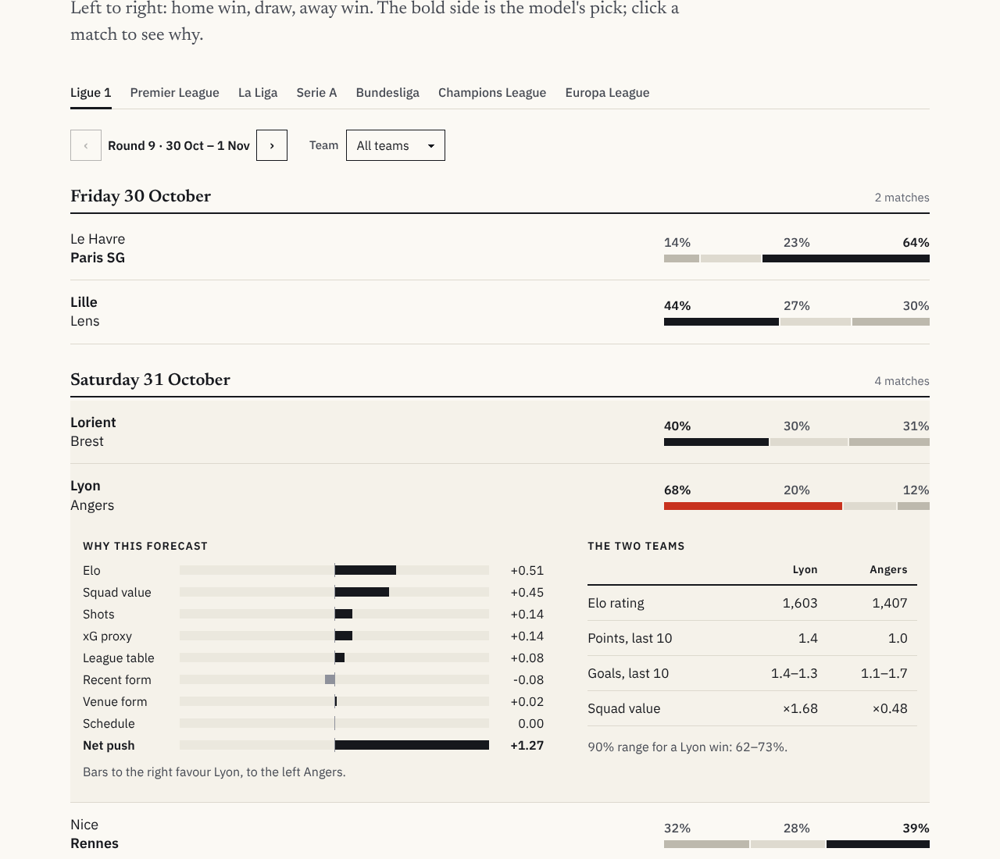

# OL·LAB: predicting Olympique Lyonnais with machine learning

Can a model predict football results better than Elo ratings or the bookmakers? This project tests it on the five major European leagues, with Olympique Lyonnais (OL) as the case study.

**[Open the website](https://raw.githack.com/lacostetheo/ML-PREDICTION-OLYMPIQUE-LYONNAIS/main/site/ol-lab-standalone.html)**

**[Read the paper (PDF)](reports/OL_ML_project.pdf)**

<p align="center">
  <video src="https://github.com/lacostetheo/ML-PREDICTION-OLYMPIQUE-LYONNAIS/raw/main/docs/media/site_tour.mp4" poster="https://github.com/lacostetheo/ML-PREDICTION-OLYMPIQUE-LYONNAIS/raw/main/reports/figures/site_picks.png" controls muted loop autoplay playsinline width="100%"></video>
</p>

## In short

**Model.** Multinomial logistic regression on 100 inputs (Elo, squad market value, recent form, shots, schedule), refitted every season.

**Alternatives tested.** Gradient boosting, random forest, SVM, neural networks. None beats the logistic regression significantly, so the simplest model is kept.

**Result.** Team strength (Elo and squad value) explains almost everything that can be predicted. The probabilities are well calibrated, but the bookmaker is still better (log loss 0.966 against 0.979), and adding our model to its prices adds nothing.

**For OL (Ligue 1 2026/27, state on 27 October 2026).**

- 54.6 expected points (80% interval 46 to 63)
- average final position: 5.9
- 23% chance of a Champions League place, 1% chance of the title
- 4% chance of winning the Europa League
- next match, Lyon - Angers: 68% win, 20% draw, 12% defeat

## Where to look

| What | Where |
|---|---|
| Website, no install | [open it](https://raw.githack.com/lacostetheo/ML-PREDICTION-OLYMPIQUE-LYONNAIS/main/site/ol-lab-standalone.html), or download `site/ol-lab-standalone.html` and double-click it |
| Paper, 13 pages | [`reports/OL_ML_project.pdf`](reports/OL_ML_project.pdf), written before Paris SG - Lyon, so its forecast for that match is a real pre-match forecast |
| Paper rebuilt with the latest data | [`reports/OL_ML_project_updated.pdf`](reports/OL_ML_project_updated.pdf) |
| Dashboard | `make dashboard` |
| Notebooks | [`notebooks/`](notebooks/), 01 to 08 |
| Details of each phase | [`docs/`](docs/) |

## How it works


**Glossary**

- **Elo**: a strength score updated after every match.
- **Log loss**: punishes confident wrong forecasts. Lower is better. 1.075 means ignoring team quality, 0.966 is the bookmaker.
- **Calibration**: a "70%" forecast should come true about 70% of the time.
- **Walk-forward**: train on the past, predict the next season, repeat (see [the split](#train-validation-and-test-split)).
- **Leakage**: using information from after the match.
- **Monte Carlo**: replay the season thousands of times with the model's probabilities.

## Train, validation and test split

Seasons are named by their start year: 2011 means 2011/12.

| Period | Seasons | Dates | Matches | Used for |
|---|---|---|---|---|
| Warm-up | 2010/11 | Aug 2010 to May 2011 | 1,826 | Elo and rolling features only, never fitted |
| **Train** | 2011/12 to 2020/21 | Aug 2011 to May 2021 | about 18,200 | fitting the models, tuning with time-ordered cross-validation |
| **Validation** | 2021/22 and 2022/23 | Aug 2021 to May 2023 | 3,652 | comparing models and choosing the final features |
| **Test** | 2023/24 to 2026/27 | Aug 2023 to 26 Oct 2026 | 5,650 | final score, used once, nothing tuned on it |

The split is by time, never random: a model never sees a match that is later than the ones it predicts.

The test is **walk-forward**. Each test season is predicted by a model refitted on all the seasons before it:

| Season predicted | Model fitted on |
|---|---|
| 2023/24 | 2011/12 to 2022/23 |
| 2024/25 | 2011/12 to 2023/24 |
| 2025/26 | 2011/12 to 2024/25 |
| 2026/27 (until 26 Oct 2026) | 2011/12 to 2025/26 |

Hyper-parameters are frozen before the test. Elo and form features are updated after every match, the model weights once a year.

The forecasts for the matches still to play use all the matches played so far.

## Results

Test seasons 2023 to 2026, 5,650 matches.

| Model | Accuracy | Log loss [95% CI] | Brier | Calibration error |
|---|---|---|---|---|
| Baseline (class frequencies) | 43.2% | 1.0754 [1.069, 1.082] | 0.651 | 0.012 |
| Elo | 52.5% | 0.9892 [0.979, 0.999] | 0.590 | 0.017 |
| Poisson goals | 52.0% | 0.9907 [0.980, 1.001] | 0.591 | 0.022 |
| **Logistic regression (chosen)** | 53.2% | **0.9794** [0.969, 0.990] | 0.584 | 0.017 |
| Gradient boosting | 52.9% | 0.9787 [0.968, 0.989] | 0.583 | 0.020 |
| Neural network (MLP) | 52.9% | 0.9799 [0.970, 0.990] | 0.584 | 0.021 |
| Ensemble of the three | 53.0% | 0.9781 [0.968, 0.988] | 0.583 | 0.017 |
| *Bookmaker (Bet365)* | *53.9%* | *0.9659* [0.956, 0.976] | *0.574* | *0.022* |


- The logistic regression beats Elo (-0.0098, CI [-0.0137, -0.0060]).
- Boosting and the neural network do not beat it (-0.0007 and +0.0005, the intervals contain 0).
- The bookmaker beats everyone (+0.0136, CI [+0.0093, +0.0178]).
- Draws are almost impossible to predict: the draw is the most likely outcome in only 6 of 5,650 matches. Accuracy is therefore a weak summary, and log loss is the better yardstick.
- What explains results: Elo and squad value dominate. Recent form and shots add a little. Rest, league position and venue form add nothing ([details](docs/phase7_interpretability.md)).
- Updating the weights as results arrive brings no measurable gain.
- Pooling our probabilities with the market's, the best weight on our model is 0.00. The market already contains what the model knows. This is an efficiency test only, no betting strategy is built.
- Ablation: Elo alone 0.9957, plus form 0.9931, plus shots 0.9887, plus table and fatigue 0.9890 (no gain), plus squad value 0.9870.

Full discussion: [`docs/final_evaluation.md`](docs/final_evaluation.md).

## OL and the season simulation

OL is 6th in Ligue 1 by Elo after the 0-2 defeat at Paris SG on 26 October (the model had picked Paris at 63%). It is 5th by squad value and 10th for recent form.

Each forecast carries two uncertainties: the model (100 bootstrap refits) and team strength (Elo, plus or minus 60 points).

The simulator was backtested on 2023 to 2025. The error on final points is 6.4, against 8.9 for the naive reference. Its "80%" intervals only covered 72% of cases, so read them as lower bounds.


| Ligue 1 2026/27 | Expected points [80%] | Title | Champions League (top 3) | Top 6 | Relegation |
|---|---|---|---|---|---|
| Paris SG | 73.0 [65-81] | 83.8% | 97.8% | 99.9% | 0% |
| Monaco | 60.5 [52-69] | 6.6% | 55.0% | 87.3% | 0% |
| **Lyon** | **54.6 [46-63]** | **1.4%** | **22.8%** | **60.9%** | **< 0.1%** |

European places are assumptions (`configs/leagues.json`). OL also plays the Europa League this season, see [`docs/europe_ucl.md`](docs/europe_ucl.md).

Reports: [`docs/phase8_ol_predictions.md`](docs/phase8_ol_predictions.md) and [`docs/phase9_season_simulation.md`](docs/phase9_season_simulation.md).

## Website



Six pages:

1. **Picks**: the model's pick in each competition (five leagues, Champions League, Europa League), then Lyon's next matches and where it should finish.
2. **Matches**: forecasts for every match still to play. Click a league match to see how Elo, squad value and form add up to the forecast.
3. **Standings**: projected final tables with title, Europe and relegation odds.
4. **Team**: any club of the five leagues, with its Elo since 2016.
5. **Results**: the recent matches, the probabilities given before kick-off and what happened. These forecasts are recomputed after the fact, they were not published in advance.
6. **Method**: the model, the comparison with other forecasters, the definition of Elo, the limits.

**Weekly update.** Every Monday, `.github/workflows/weekly.yml` downloads the new results, refits the model, reruns the simulations and republishes the site. The update date is shown in the header and the footer. The paper is not regenerated.

For this to run, GitHub Pages must be set to "GitHub Actions" (Settings, Pages) and the workflow permissions to "Read and write" (Settings, Actions, General). By hand: `make weekly` (about 40 minutes, needs internet).

Calendars come from openfootball (four leagues), Maxifoot (Ligue 1) and Wikipedia (European cups). A match still unplayed after its date is flagged as postponed. The browser does no machine learning: every number is precomputed in Python.

## Method

**Data.** Results, shots and odds from [football-data.co.uk](https://football-data.co.uk/data.php) (private, non-commercial use, raw files are not redistributed). Squad values from the CC0 [Transfermarkt dataset](https://github.com/dcaribou/transfermarkt-datasets). Rejected: FBref advanced data (removed in January 2026), Understat (`robots.txt` forbids it), ClubElo (unreachable). Terms and biases: [`docs/data_sources.md`](docs/data_sources.md).

**No leakage.**

- Rolling windows are shifted by one match.
- Elo is stored before it is updated.
- Squad values are dated before the snapshot.
- Bookmaker odds are never a feature.
- An automated test replaces every result after a cutoff with random values and checks that earlier features are identical. It fails on two deliberately injected bugs.

Details: [`docs/features.md`](docs/features.md).

**Two data lessons.** The "xG proxy" is only `0.287 x shots on target`. Variables that count matches seen so far act as a calendar clock, so they were removed.

**Validation.** Train 2011/12 to 2020/21, validate 2021/22 to 2022/23, test 2023/24 to October 2026 (see [the split](#train-validation-and-test-split)). Main metric: log loss. Differences are tested with a paired block bootstrap by calendar week.

**Models.** scikit-learn only. No LSTM or GRU.

## Limitations

- No injuries, line-ups or coaching information. This is the likely source of the gap to the bookmaker.
- No real xG.
- Squad values are a crowd-sourced snapshot (June 2026), with 13 unmatched clubs.
- Bookmaker prices are Bet365 pre-match, with a simple margin removal.
- Few validation windows, SVM under-tuned, simulation intervals too narrow.
- UEFA places are assumed.
- Wikipedia's Champions League page lags: 29 of the 54 matches played on 27 October were recorded, the others are simulated.

## Reproduce

```bash
git clone https://github.com/lacostetheo/ML-PREDICTION-OLYMPIQUE-LYONNAIS
cd ML-PREDICTION-OLYMPIQUE-LYONNAIS
pip install -r requirements.txt     # Python 3.12, or: conda env create -f environment.yml

make pipeline    # data, features, backtest, OL predictions, simulations (~25 min, needs internet)
make site        # export site data and build site/ol-lab-standalone.html
make weekly      # after each round: new results, refit, simulations, Europe, site (~40 min)
make report      # the paper (needs LaTeX)
make dashboard   # Streamlit app
make all         # every experiment (~1 h)
make test        # 26 tests, including the leakage test
```

Seeds are fixed and raw data is downloaded, not committed. Re-running later includes newer matches: the committed tables correspond to 27 October 2026 (results through 26 October).

```
site/                 website (index.html, app.js, style.css, data.js, fonts/)
app/streamlit_app.py  dashboard
src/olpred/           data, features, models, evaluation, predictions, charts
notebooks/            01 exploration to 08 final evaluation
docs/                 data sources, features, one report per phase
reports/              paper (PDF), tables, figures
configs/leagues.json  league places (assumptions)
tests/                leakage, metrics, online learning, dashboard, site data
```

---

Author: Théo Lacoste, EDHEC Business School (BBA). Academic project, not betting advice. Data under its own terms (see `docs/data_sources.md`).

I thank my machine learning courses and my internship as a data scientist, which helped me a lot on this project.
