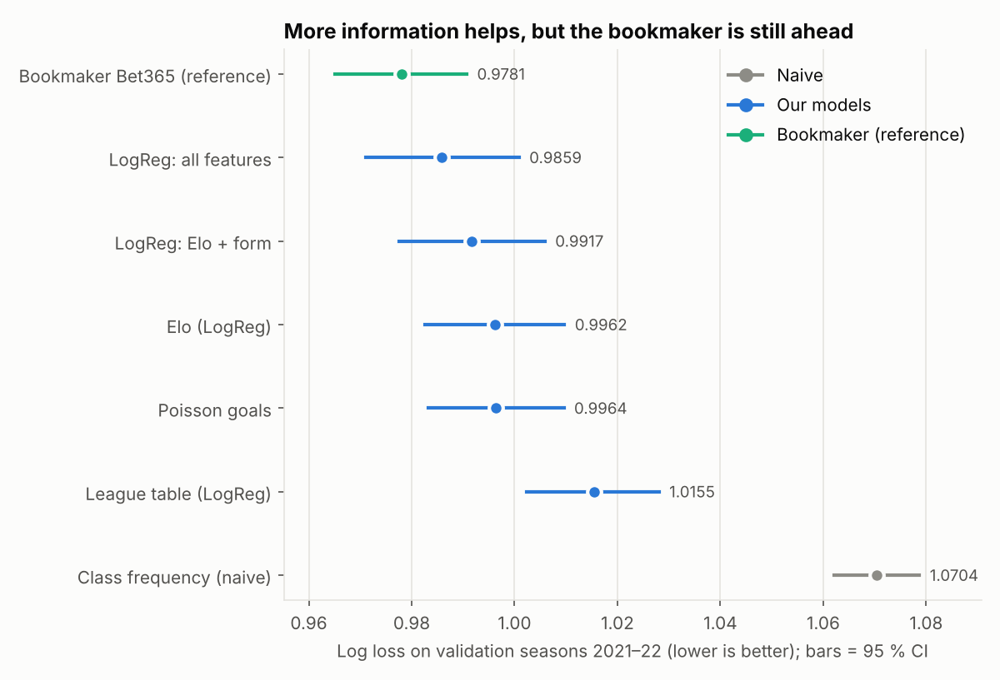
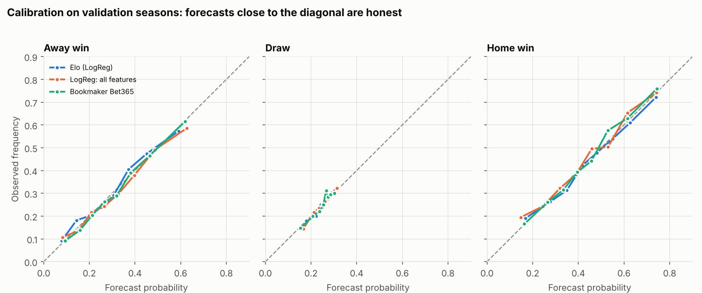

# Phase 4 — Baselines (validation seasons 2021–22)

Reproduce: `python -m olpred.run_baselines && python -m olpred.viz.baseline_plots`

Models are fitted on seasons 2011–2020 and scored on **2021–22 (3,651 matches)**.
The test seasons (2023 →) have **not been touched**. Matches without Bet365 odds
(1 in validation) are dropped for every model so all comparisons are paired.
Regularisation strength C is chosen by time-ordered cross-validation *inside the
training set*; nothing is tuned on the validation seasons.

## Results

| Model | Log loss ↓ | Brier ↓ | RPS ↓ | Accuracy | F1 macro | ECE ↓ |
|---|---|---|---|---|---|---|
| Class frequency (naive) | 1.0704 | 0.6474 | 0.2298 | 44.2 % | 0.205 | – |
| League table (LogReg) | 1.0155 | 0.6085 | 0.2105 | 51.1 % | 0.371 | 0.021 |
| Elo (LogReg) | 0.9962 | 0.5940 | 0.2038 | 52.5 % | 0.388 | 0.015 |
| Poisson goals | 0.9964 | 0.5943 | 0.2039 | 52.6 % | 0.389 | 0.020 |
| LogReg: Elo + form | 0.9917 | 0.5909 | 0.2025 | 52.9 % | 0.392 | 0.018 |
| **LogReg: all features** (106 cols, C = 0.0027) | **0.9859** | 0.5868 | 0.2009 | 53.0 % | 0.399 | 0.019 |
| *Bookmaker Bet365 (reference)* | *0.9781* | 0.5819 | 0.1983 | 53.4 % | 0.398 | 0.017 |

Pairwise differences in log loss use a paired **block bootstrap** (whole calendar
weeks resampled, 4,000 draws, 95 % CI; `reports/tables/phase4_baselines_val_bootstrap.csv`).

| Comparison | Δ log loss | 95 % CI | Significant |
|---|---|---|---|
| Elo vs naive | −0.074 | [−0.086, −0.062] | yes |
| Poisson vs Elo | +0.000 | [−0.002, +0.003] | **no** |
| Elo + form vs Elo | −0.0045 | [−0.008, −0.001] | yes |
| All features vs Elo | −0.0103 | [−0.016, −0.005] | yes |
| All features vs bookmaker | +0.0078 | [+0.002, +0.013] | yes (bookmaker better) |

## What this says

1. **Almost all of the predictive power is in team strength.** Going from the naive
   rate to Elo removes 0.074 of log loss; everything else we add (form, league table
   position, shots, squad value, fatigue) together adds another 0.010.
2. **A simple Elo is hard to beat.** Poisson goals regression is statistically
   indistinguishable from Elo; the league-table baseline is clearly worse (position
   mid-season is a noisy strength measure).
3. **Extra features help, modestly but measurably.** The best logistic model has a
   significantly lower log loss than Elo alone (−0.010). Its very strong
   regularisation (C = 0.0027) signals that many of the 106 columns are redundant
   (the `xg_*` columns are collinear with shots on target; rolling windows overlap).
4. **The bookmaker is still significantly better** than our best model
   (+0.008 log loss). We should expect that closing odds contain information we do
   not have (line-ups, injuries, news, sharp money). Closing that gap, or showing it
   cannot be closed with public data, is the question of the finance extension.
5. **Draws are essentially unpredictable.** F1 for the draw class is ≈ 0 for every
   model (the draw probability stays in 15–32 %, never the arg-max). Accuracy
   therefore says little; probabilistic metrics are the right yardstick.
6. **Calibration is good** for all models (ECE 1.5–2.1 %): the probabilities can be
   taken at face value, which matters for the season simulation.

## Caveats

- One validation window of two seasons (2021–22, right after the COVID period, with
  crowds returning) — a single period is not proof of robustness; the walk-forward
  evaluation in Phase 5 will repeat the comparison over several periods.
- Elo hyper-parameters (K, home advantage, shrinkage) are conventional values, not tuned.
- Differences below ≈ 0.003 in log loss are within noise at this sample size.

## Bar for Phase 5

Beat **0.9859** (all-features logistic regression) with a statistically significant
margin to claim that a non-linear model adds value; the realistic expectation is
gains of at most a few thousandths, and it is a legitimate result if there are none.
