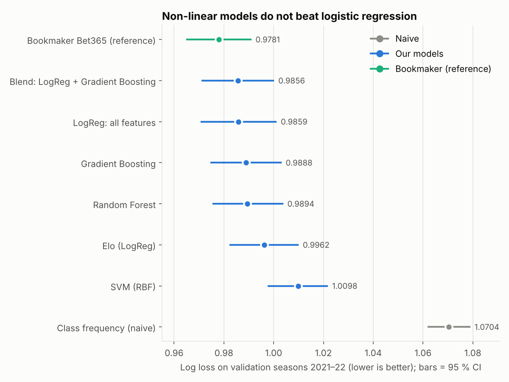
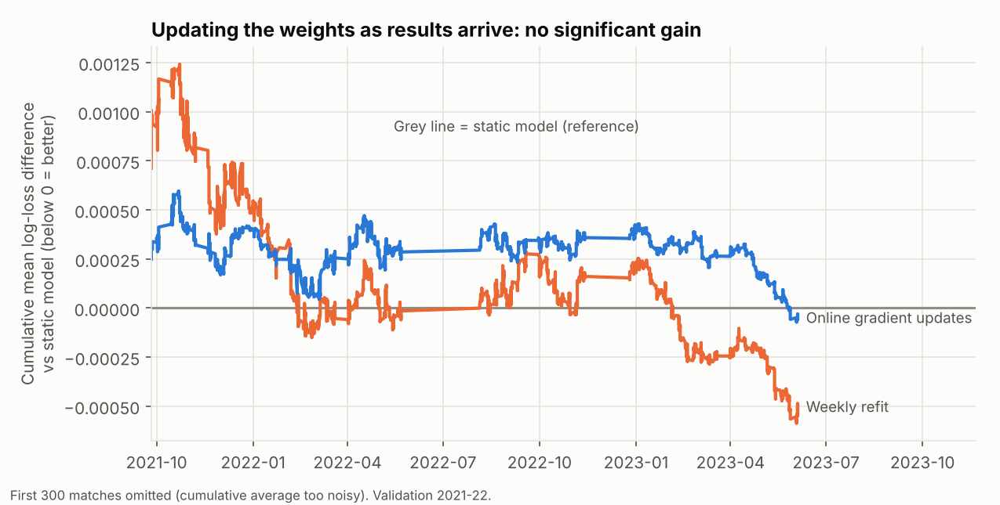

# Phase 5 — Classical machine learning and online updating

Reproduce:
`python -m olpred.run_ml && python -m olpred.run_online && python -m olpred.viz.ml_plots`

Same protocol as Phase 4: fit on seasons 2011–2020, score on **validation 2021–22**
(3,651 matches), **test seasons untouched**. Hyper-parameters are chosen *only*
inside the training seasons, with time-ordered cross-validation (`TimeSeriesSplit`,
log loss): each fold trains on the past and scores the next block.

## 1. Hyper-parameter search

| Model | Method | Space searched | Best configuration | CV log loss |
|---|---|---|---|---|
| Random Forest | Random search, 12 draws × 5 time folds | trees {200, 400}; max depth {4, 6, 8, 12, none}; min leaf {10, 25, 50, 100}; max features {√p, 0.3, 0.5} | 400 trees, depth 6, min leaf 10, max features 0.3 | 0.9784 |
| Gradient boosting (`HistGradientBoosting`) | Random search, 20 draws × 5 time folds | learning rate log-uniform [0.01, 0.2]; iterations {50, 100, 200, 400}; depth {2, 3, 4, none}; leaves {8, 15, 31}; min leaf {20, 50, 100, 200}; L2 {0, 0.1, 1, 10} | lr 0.029, 100 iterations, depth 2, 15 leaves, min leaf 200, L2 = 1 | 0.9799 |
| SVM (RBF) | Grid, 4 combinations × 3 time folds, 7 features only (cost ∝ n²) | C {0.3, 1}; γ {0.02, scale} | C = 0.3, γ = 0.02 | 1.0034 |
| Logistic regression | `LogisticRegressionCV`, 8 values of C (10⁻⁴ … 10¹) × 5 time folds | — | C = 0.0027 | — |

Full list of configurations tried: `reports/tables/phase5_tuning.csv`.

- Gradient boosting is **strongly penalised for complexity** by the search: the best
  models are shallow (depth 2), with few iterations; the worst configuration tried
  (deep, 400 iterations, fast learning) reaches a CV log loss of 1.20 — overfitting
  is easy on 20,000 noisy rows.
- Early stopping is switched off for boosting: scikit-learn's built-in version holds
  out a *random* validation set, which would mix future and past matches.
- The SVM's best point sits on the edge of its small grid (smallest C and γ), so it
  is **under-tuned**; its poor score should not be over-interpreted (see caveats).

## 2. Results on validation 2021–22

| Model | Log loss ↓ | Brier ↓ | Accuracy | ECE ↓ | Fit time |
|---|---|---|---|---|---|
| Class frequency (naive) | 1.0704 | 0.6474 | 44.2 % | – | – |
| Elo (LogReg) | 0.9962 | 0.5940 | 52.5 % | 0.015 | – |
| **LogReg: all features** | **0.9859** | 0.5868 | 53.0 % | 0.019 | s |
| Gradient boosting | 0.9888 | 0.5890 | 53.1 % | 0.022 | 117 s |
| Random Forest | 0.9894 | 0.5893 | 53.3 % | 0.022 | 292 s |
| Blend: LogReg + Gradient boosting | 0.9856 | 0.5869 | 53.3 % | 0.022 | – |
| SVM (RBF, 7 features) | 1.0098 | 0.6038 | 51.9 % | 0.046 | 141 s |
| *Bookmaker Bet365 (reference)* | *0.9781* | 0.5819 | 53.4 % | 0.017 | – |

Paired block bootstrap (weeks resampled, 95 % CI) on the log-loss difference:

| Comparison | Δ log loss | 95 % CI | Significant |
|---|---|---|---|
| Random Forest vs LogReg (all) | +0.0035 | [−0.0007, +0.0076] | no |
| Gradient boosting vs LogReg (all) | +0.0030 | [−0.0012, +0.0070] | no |
| Blend vs LogReg (all) | −0.0003 | [−0.0024, +0.0018] | no |
| Random Forest vs Elo | −0.0068 | [−0.0107, −0.0027] | yes |
| Gradient boosting vs Elo | −0.0073 | [−0.0119, −0.0025] | yes |
| SVM vs LogReg (all) | +0.0239 | [+0.0171, +0.0308] | yes (SVM worse) |
| Best of ours (Blend) vs bookmaker | +0.0076 | [+0.0027, +0.0122] | yes (bookmaker better) |

### Robustness (log loss by validation season / league)

| | 2021 | 2022 | | Premier L. | Ligue 1 | Serie A | Bundesliga | La Liga |
|---|---|---|---|---|---|---|---|---|
| LogReg (all) | 0.9906 | 0.9812 | | 0.9666 | 0.9910 | 0.9800 | 0.9960 | 0.9978 |
| Gradient boosting | 0.9919 | 0.9858 | | 0.9673 | 0.9959 | 0.9843 | 1.0009 | 0.9982 |
| Random Forest | 0.9935 | 0.9854 | | 0.9658 | 0.9980 | 0.9867 | 0.9990 | 0.9996 |
| Bookmaker | 0.9772 | 0.9789 | | 0.9517 | 0.9859 | 0.9793 | 0.9924 | 0.9838 |

The ranking is stable: logistic regression is at least as good as the tree models
in both seasons and in four of five leagues (random forest is marginally ahead only
in the Premier League). The gap to the bookmaker is not constant: 0.013 in 2021 but
only 0.002 in 2022, and almost nil in Serie A.

## 3. Does updating the weights as results arrive help?

Regimes compared on the *same* stream of matches, predicted week by week (each week
is predicted first, then its results are revealed):

- **Static**: logistic regression fitted once on 2011–2020.
- **Online**: same model, weights updated by gradient descent on the log loss after
  each week (`OnlineSoftmax`: `W ← W − η[(P − Y)ᵀX/n + λW]`, λ matching the batch
  model's L2 penalty).
- **Refit**: full re-estimation every week on all results seen so far (upper bound
  of what "learning continually" can bring to this model class).

The learning rate η was chosen on a pseudo-stream *inside the training period* (base
model fitted up to 2018, stream = seasons 2019–2020), over {10⁻⁴, 3·10⁻⁴, 10⁻³,
3·10⁻³, 10⁻², 3·10⁻²}: η = 10⁻³ (`phase5_online_lr_selection.csv`). Larger steps are
harmful — η = 0.03 raises the log loss from 1.001 to 1.069 — because a week holds only
about 60 noisy outcomes.

| Regime | Log loss | Δ vs static | 95 % CI | Significant |
|---|---|---|---|---|
| Static | 0.9859 | – | – | – |
| Online (gradient updates) | 0.9858 | −0.00005 | [−0.0006, +0.0005] | no |
| Weekly refit | 0.9854 | −0.0005 | [−0.0012, +0.0002] | no |

**Reading:** with ~20,000 matches already in the training set, a week of results adds
0.3 % more data; the optimal weights barely move, and any gain is below what can be
detected. This is *not* an argument against continual learning in the project: the
part that must adapt quickly — team strength — already does, because the Elo rating
and the rolling form features are recomputed after every match. What this experiment
shows is that re-estimating the *weights* on top of that adds nothing measurable.

## 4. Conclusions

1. **No evidence that non-linear models help.** Random forest and gradient boosting
   are at best equal to a regularised logistic regression (difference +0.003, CI
   includes 0; blending changes nothing). All beat Elo-only, so the features carry
   signal, but it is essentially linear and low-dimensional.
2. **The bookmaker remains ahead** (+0.008 log loss for our best), with a gap that
   varies by season.
3. **Online weight updates add nothing measurable** over a static model; the
   adaptivity that matters is already in the features.
4. Simple is preferable: the logistic regression is the reference to beat in Phase 6
   (neural networks) — if the MLP does not improve on 0.9859 significantly, it will
   not be retained.

## 5. Caveats

- One validation window (2021–22). The test seasons remain for the final comparison.
- The SVM used a compact feature set and a 4-point grid ending at the grid edge: its
  weaker result partly reflects under-tuning and fewer features, not only the method.
- CV log loss on the training folds (≈ 0.978) is lower than the validation log loss
  (≈ 0.989): the folds are earlier, easier periods — one more reason not to compare
  CV numbers across models trained on different windows.
- Online updating was tested for the linear model only. Tree models cannot be updated
  by gradient steps; a refit-per-season experiment for them is possible but unlikely
  to change the conclusion.
- Tuning uses scikit-learn's histogram gradient boosting, not XGBoost/LightGBM
  (course scope: scikit-learn only).
