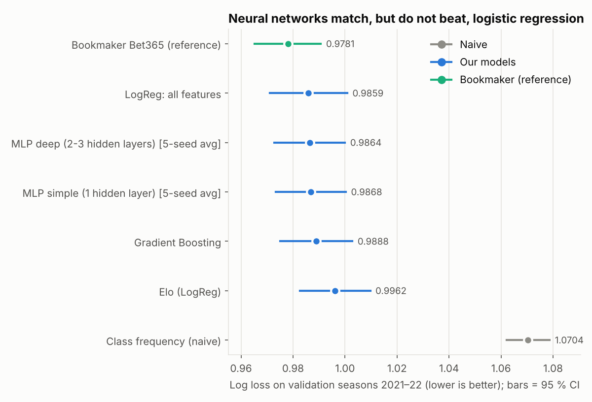
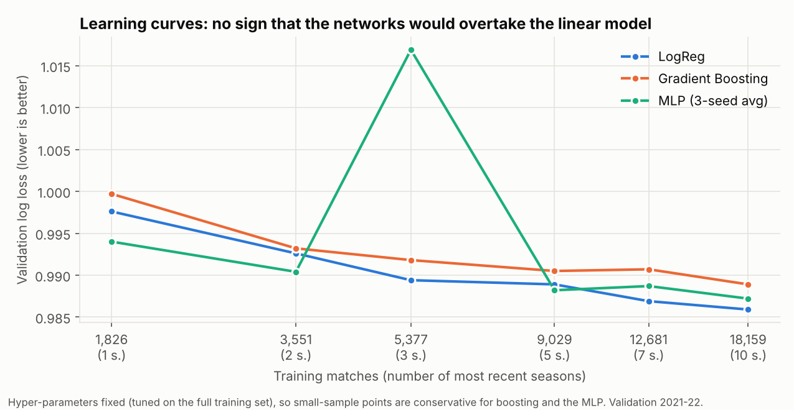

# Phase 6 — Neural networks

Reproduce: `python -m olpred.run_nn && python -m olpred.viz.ml_plots`

Same protocol as before: fit on seasons 2011–2020, score on **validation 2021–22**
(3,651 matches), **test untouched**, hyper-parameters chosen by time-ordered
cross-validation inside the training seasons. The question is not "can a network
fit the data?" but **"does it beat a regularised logistic regression (0.9859)?"**

## What scikit-learn can and cannot do

The architectures sketched in the project brief use Dropout and Batch Normalisation.
`MLPClassifier` has neither. Regularisation instead comes from:

| Role of dropout / batch-norm | What is used here |
|---|---|
| Prevent over-fitting | Strong **L2 penalty** (`alpha` searched over 0.1–100) and **few epochs** (10–80, chosen by CV) |
| Reduce variance | **Average of 5 random initialisations** (`SeedEnsemble`) |
| Stable training | Standardised inputs, Adam optimiser, mini-batches of 256 |

`early_stopping` is switched off on purpose: scikit-learn's version holds out a
*random* subset, mixing future and past matches (temporal leakage). Dropout/BatchNorm
would need Keras or PyTorch, which are outside the course scope.

LSTM/GRU were **not** built: the rolling Elo / form features already summarise each
team's history, there are only ~20,000 training rows, and a recurrent model would add
variance without new information. This is a deliberate decision, not an omission.

## Architectures and hyper-parameter search

Random search, 20 draws × 5 time folds each (log loss). Full results:
`reports/tables/phase6_tuning.csv`.

| Network | Hidden layers searched | Best configuration | CV log loss |
|---|---|---|---|
| Simple MLP: input → Dense(ReLU) → softmax | (8), (16), (32), (64) | (16), alpha = 12.4, lr = 0.0027, 40 epochs | 0.9796 |
| Deep MLP: input → Dense(ReLU) ×2–3 → softmax | (32,16), (64,32), (64,32,16), (128,64,32) | (64,32), alpha = 4.3, lr = 0.0008, 40 epochs | 0.9801 |

Common space: alpha log-uniform [0.1, 100], learning rate log-uniform [1e-4, 3e-3],
epochs {10, 20, 40, 80}. Search sensitivity is high: the **median** configuration
scores 0.997–1.001 and the worst 1.04–1.12, i.e. a network without careful
regularisation is *worse than predicting Elo only*. The winners use very strong L2
(alpha 4–12), which pushes them toward an almost linear function.

## Results on validation

| Model | Log loss ↓ | Brier ↓ | Accuracy | ECE ↓ |
|---|---|---|---|---|
| LogReg: all features (reference) | **0.9859** | 0.5868 | 53.0 % | 0.019 |
| MLP deep, 5-seed average | 0.9864 | 0.5873 | 52.9 % | 0.019 |
| MLP simple, 5-seed average | 0.9868 | 0.5877 | 53.0 % | 0.020 |
| MLP deep, 1 seed | 0.9870 | 0.5876 | 52.9 % | 0.020 |
| MLP simple, 1 seed | 0.9874 | 0.5880 | 52.8 % | 0.020 |
| Gradient boosting (Phase 5) | 0.9888 | 0.5890 | 53.1 % | 0.022 |
| *Bookmaker Bet365 (reference)* | *0.9781* | 0.5819 | 53.4 % | 0.017 |

Paired block bootstrap (weeks resampled), difference in log loss:

| Comparison | Δ | 95 % CI | Significant |
|---|---|---|---|
| MLP deep (5 seeds) vs LogReg | +0.0005 | [−0.0030, +0.0037] | no |
| MLP simple (5 seeds) vs LogReg | +0.0010 | [−0.0029, +0.0046] | no |
| MLP deep (5 seeds) vs gradient boosting | −0.0025 | [−0.0056, +0.0005] | no |
| MLP deep (5 seeds) vs Elo | −0.0098 | [−0.0150, −0.0045] | yes |
| MLP deep (5 seeds) vs bookmaker | +0.0083 | [+0.0038, +0.0128] | yes (bookmaker better) |

- Averaging 5 seeds improves each network by 0.0004–0.0006 — small, consistent.
- Deep vs simple: no difference (0.0004).
- **Decision rule set in Phase 5: a network is retained only if it beats 0.9859
  significantly. None does. The logistic regression remains the reference model.**

## Is the dataset big enough for a network?

Learning curve: train on the most recent *k* seasons before 2021 (hyper-parameters
fixed at the full-data optimum), score on validation.

| Training matches | LogReg | Gradient boosting | MLP (3 seeds) |
|---|---|---|---|
| 1,826 | 0.9976 | 0.9997 | 0.9940 |
| 3,551 | 0.9926 | 0.9932 | 0.9904 |
| 5,377 | 0.9894 | 0.9918 | **1.0169** |
| 9,029 | 0.9889 | 0.9905 | 0.9882 |
| 12,681 | 0.9869 | 0.9907 | 0.9887 |
| 18,159 | **0.9859** | 0.9889 | 0.9872 |

Reading, with caution:
- Every model improves with more data, and none is flattening dramatically, but at the
  full size the two non-linear families are still 0.001–0.003 *behind* the linear one:
  nothing in the curve suggests that a few more seasons would flip the ranking.
- With 1–2 seasons the MLP is nominally the best (0.9940 vs 0.9976). These samples
  are small and the differences are within noise; I do not read this as a real
  small-sample advantage.
- The spike at 3 seasons (1.017) shows the network's **instability**: with the number
  of epochs fixed, fewer rows means fewer gradient steps and the early-stopped network
  can land in a poor spot. This is a caveat of the protocol (fixed epochs), but it
  also illustrates the practical point: the linear model needs no such care.
- Football outcomes are noisy (draw ≈ 25 %, upsets frequent); the achievable signal is
  small, so extra model capacity has little to capture. A bigger dataset would not
  change the signal-to-noise ratio.

## Conclusions

1. **Neural networks do not add value** over regularised logistic regression on this
   problem: the best network is statistically tied (+0.0005, CI includes 0) at a
   much higher cost in tuning effort and instability.
2. The best networks are heavily regularised toward near-linear functions — the data
   do not reward flexibility.
3. This is a legitimate and informative result: the simple model is preferable, as
   anticipated in the project's design.

## Caveats

- One validation window (2021–22); the test seasons are reserved for the final comparison.
- No dropout / batch normalisation (library limit); results might differ marginally with them.
- Online weight updates were tested for the linear model only (Phase 5). The network was
  not updated sequentially: `MLPClassifier.partial_fit` makes the step size awkward to
  control and the linear experiment already showed no gain.
- The learning curve holds hyper-parameters fixed and uses 3 seeds, so small-sample
  points are noisy and conservative.
