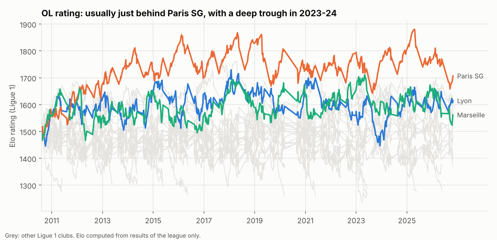
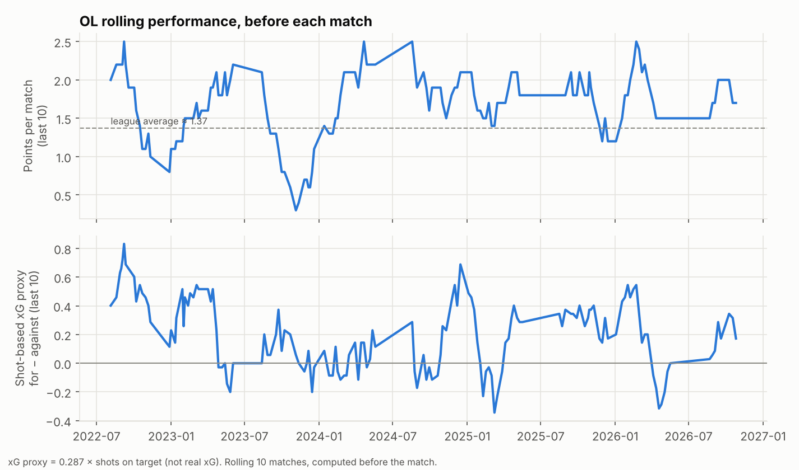
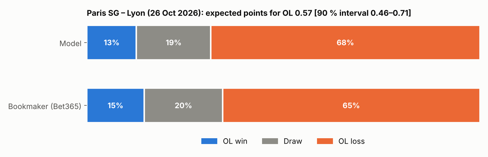

# Phase 8 — Olympique Lyonnais: predictive model

Reproduce: `python -m olpred.run_backtest` (once) → `python -m olpred.run_ol` → `python -m olpred.viz.ol_plots`

**State date: 2026-10-26.** Football-data's last Ligue 1 result is 2026-10-18 (7 rounds
played). Results of the 23–25 October fixtures, if already played, are not in the data.

## What is predicted, and with which model

The production model is the **final logistic regression** (100 curated features), refit on
every played match since 2011. (The 3-model ensemble was marginally better in the test
evaluation, −0.0014 log loss, but the logistic regression is simpler, exactly linear, and
is what makes the fast season simulation of Phase 9 possible.)

**Features of future fixtures reuse the training code exactly.** To score a match not yet
played, the pipeline appends one *phantom* match per team on the prediction date (no
result) and reads each team's pre-match features from it. A unit test shows that, for any
past date, this reproduces the training table to machine precision
(`tests/test_leakage.py::test_future_fixture_features_equal_training_features`).

## Current team strength

| Dimension | OL | Rank in Ligue 1 |
|---|---|---|
| Elo rating | 1,615 | **3 / 18** (PSG 1,707; Lille 1,619) |
| Recent form, points/match (last 10) | 1.70 | 5 / 18 |
| Goals scored / conceded per match (last 10) | 1.80 / 1.30 | 5 / 6 |
| Shots on target for / against (last 10) | 5.0 / 4.4 | 10 / 8 |
| Squad value, total (€M) | 305 | 5 / 17 |
| Attackers / midfielders / defenders / goalkeepers (€M) | 120 / 119 / 55 / 10.5 | 5 / 5 / 10 / 6 |
| Depth (value of players ranked 12–22, €M) | 79.5 | 5 / 17 |

Reading: OL's results (rank 5 for form and goals) and its rating (3rd) are *better* than
the underlying shot volume (10th for shots on target) would suggest, while its squad is
valued 5th overall with a relatively weaker defence (10th). Market values are the
Transfermarkt snapshot (valuations to June 2026; 17 clubs mapped, the two newly promoted
sides have no value). Positional values are **descriptive only** — position-level
strength was not a model input, and no data on injuries or line-ups exists in this
project.

## Match prediction

**Paris SG – Lyon (26 October 2026):**

| | OL win | Draw | OL loss | OL expected points |
|---|---|---|---|---|
| Model | 15 % | 21 % | 64 % | 0.67 |
| Bookmaker (Bet365, margin removed) | 15 % | 20 % | 65 % | – |

Intervals (90 %) on the OL win probability: **0.14–0.17 from model uncertainty alone**
(100 bootstrap refits on resampled weeks of history), and **0.12–0.21 once uncertainty on
the true strength of the two teams is added** (each team's Elo shaken by ±60 points, the
value chosen in the backtest, see Phase 9). Expected points 0.54–0.85. The match itself
remains a coin with three faces: a 15 % chance of an OL win is a real possibility.

The model and the market agree closely on this match. Over the whole round the largest
disagreement is Lens – Paris FC (model 49 % home win vs market 39 %);
`reports/tables/ol_next_round.csv` gives all nine fixtures.

### Remaining OL fixtures (27: opponents and venues, order unknown)

Using today's state and a neutral schedule, the sum of expected points over the 27
remaining matches is **43.6**, i.e. a projected **57.6 points** with the 14 already won
(Phase 9 gives the full distribution). The easiest are home games against Angers (2.35
expected points), Troyes (2.25) and Le Mans (2.17); the hardest are away at Paris SG (0.65),
Lille (1.03), Monaco (1.06) and Marseille (1.14). Table: `reports/tables/ol_remaining_fixtures.csv`.

## Uncertainty, stated plainly

- **Outcome randomness** — irreducible: even the bookmaker, with line-ups and news, only
  recovers most of it (Final evaluation, §2).
- **Model uncertainty** — shown by the thick bars: small for strong favourites and large
  for newly promoted teams (Le Mans, Troyes), whose squad value is missing and
  imputed with the training median.
- **Data (rating) uncertainty** — thin bars: the Elo rating is an estimate.
- These are the *statistical* uncertainties of this model. They do not cover what the
  model does not see: injuries, suspensions, tactical changes, a new coach.

## Does the model work for OL specifically?

On OL's 109 league matches in the test seasons the log loss was 0.982 (95 % CI
0.902–1.064) vs 0.953 for the bookmaker — consistent with the whole-sample picture;
the sample is too small for an OL-specific conclusion.

## Limitations

- State as of 26 October; results played since are not included.
- Squad values of the 2026/27 season rely on the June 2026 snapshot: summer transfers are
  not reflected (the Transfermarkt pipeline stopped in July 2026).
- No injuries, line-ups or tactical information.
