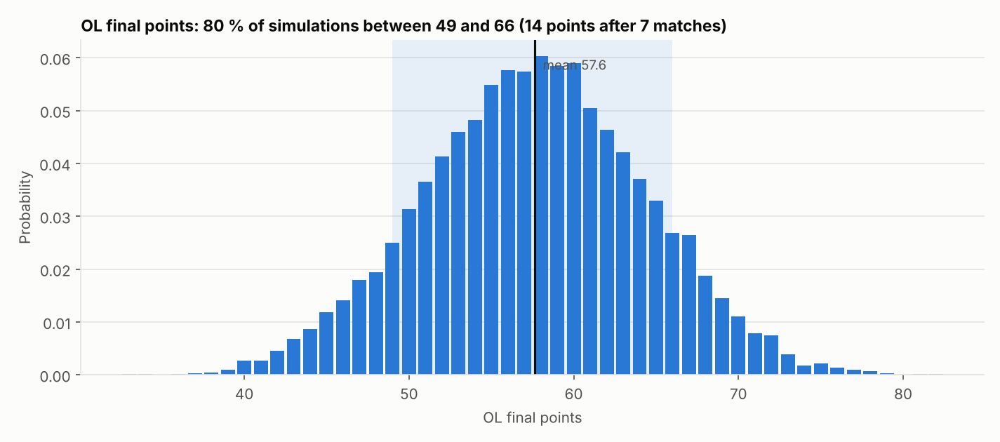
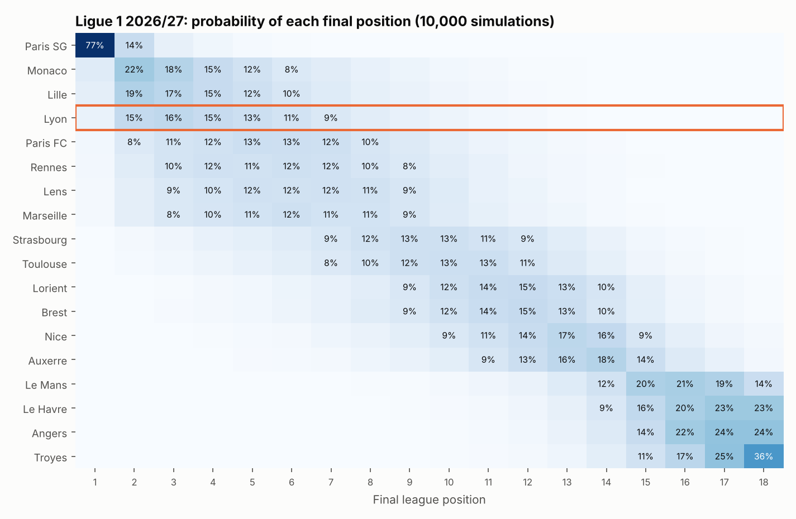

# Phase 9 — Season simulation (Monte Carlo)

Reproduce: `python -m olpred.run_backtest --reuse-tuning` → `python -m olpred.run_season_sim` →
`python -m olpred.viz.ol_plots`

## Method

For each league, **10,000 simulations** of the rest of the 2026/27 season from the state of
26 October 2026. Each simulation:

1. **Strength shock.** Every team's Elo rating is perturbed by N(0, σ) points,
   representing uncertainty on true strength over the rest of the season. The Elo
   features of all remaining fixtures move accordingly and the logistic regression's
   probabilities are recomputed exactly (the model is linear in these inputs, which makes
   the computation fast).
2. **Match outcomes.** All remaining matches (every ordered pair not yet played: 243 in
   Ligue 1) are drawn from the model's win/draw/loss probabilities, with a neutral
   schedule (7 days' rest).
3. **Scorelines.** A score consistent with the outcome is drawn from the Poisson goal
   model, to obtain goal difference and goals for.
4. **Table.** Ranked on points, goal difference, goals scored; remaining ties are
   broken at random (some leagues use head-to-head records first — ignored).

### σ is calibrated, not assumed — and the whole simulator is backtested

For each past season the simulator is run **from 31 October** with only what was known
then (data before that date, models fitted on earlier seasons), for all five leagues,
and compared with the real final tables.

| σ (Elo points) | MAE of final points | Coverage of 80 % interval | Brier title | Brier top 4 | Brier relegation |
|---|---|---|---|---|---|
| 0 | 5.92 | 73.1 % | 0.0245 | 0.0574 | 0.0786 |
| 30 | 5.92 | 75.5 % | 0.0243 | 0.0581 | 0.0774 |
| **60 (chosen)** | 5.93 | 78.2 % | 0.0243 | 0.0578 | 0.0770 |

(tuning seasons 2020–2022, 15 league-seasons; `backtest_sigma_selection.csv`.) The scores
barely depend on σ; larger values only widen the intervals toward their nominal
coverage. σ = 60 is the edge of the grid; since the Brier scores are flat there is no gain
in searching further.

**Out-of-sample evaluation, seasons 2023–2025 (15 league-seasons, 288 team-seasons):**

| Metric | Simulator | Naive reference |
|---|---|---|
| MAE of final points | **6.36** | 8.90 (current points-per-match × games) |
| Brier, title | **0.022** | 0.049 (base rate) |
| Brier, top 4 | **0.064** | 0.165 |
| Brier, top 6 | **0.089** | 0.215 |
| Brier, relegation | **0.055** | 0.117 |
| 80 % interval coverage | 72.2 % | 80 % target |

Simulated probabilities track observed frequencies closely. **The intervals are somewhat
too narrow** (72 % of actual final points fall inside the "80 %" interval): the
simulator ignores injuries, coaching changes and in-season strength drift beyond the
Elo shock, so its stated uncertainty should be read as a *lower bound*.

## Results — Ligue 1 2026/27

(Assumed UEFA slots in `configs/leagues.json`, not verified: Champions League = top 3,
other European places = top 6, direct relegation = bottom 2.)

| Team | Points now | Expected final points [80 %] | Title | Top 4 | Top 6 | Relegation |
|---|---|---|---|---|---|---|
| Paris SG | 14 | 71.9 [64–80] | 76.9 % | 98.5 % | 99.7 % | 0.0 % |
| Monaco | 14 | 59.9 [51–69] | 7.2 % | 62.3 % | 82.3 % | 0.0 % |
| Lille | 14 | 59.0 [50–68] | 5.7 % | 56.6 % | 78.6 % | 0.0 % |
| **Lyon** | **14** | **57.6 [49–66]** | **4.0 %** | **50.4 %** | **74.5 %** | **0.0 %** |
| Paris FC | 14 | 54.8 [46–64] | 1.8 % | 32.2 % | 57.9 % | 0.0 % |
| Rennes | 13 | 54.3 [45–63] | 1.6 % | 30.6 % | 54.2 % | 0.0 % |

(All teams: `reports/tables/sim_F1_summary.csv`; the four other leagues have the same files.)

### Olympique Lyonnais

| Probability | OL |
|---|---|
| Title | 4.0 % |
| Champions League (assumed top 3) | 35.7 % |
| Top 4 | 50.4 % |
| Top 6 / Europe (assumed) | 74.5 % |
| Relegation | < 0.1 % |
| Expected position | 4.9 |

OL's most likely finishes are 2nd and 3rd (15–16 % each) but the distribution is wide:
80 % of simulations give between 49 and 66 points, and 4th–6th place is almost as likely
as the top three. Seven matches in, the table is nearly flat at the top (five teams on
13–14 points), so most of the information comes from team strength, not from the table.

## Limitations

- Intervals are too narrow in the backtest (72 % vs 80 %): treat them as optimistic.
- European competitions are not modelled (no congestion effect; none was detected anyway).
- UEFA slot counts and relegation rules are assumptions; head-to-head tie-breaks ignored.
- Model probabilities for newly promoted clubs rest on little data (their squad value is
  missing and imputed).
- Strength is held at today's value apart from the random shock: transfers in January or
  a coaching change are not anticipated.
