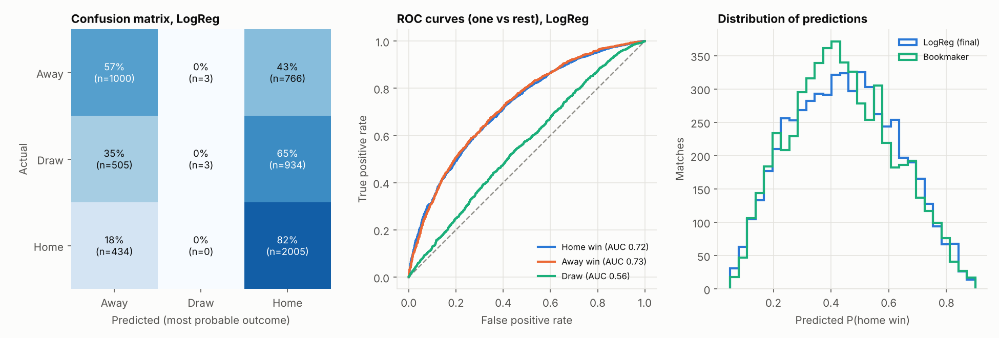
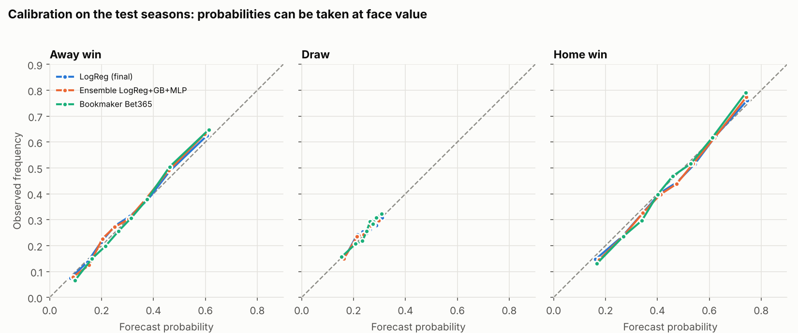
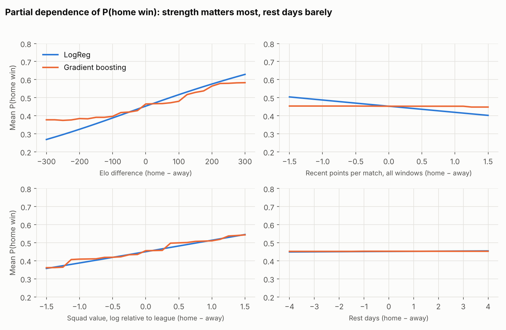
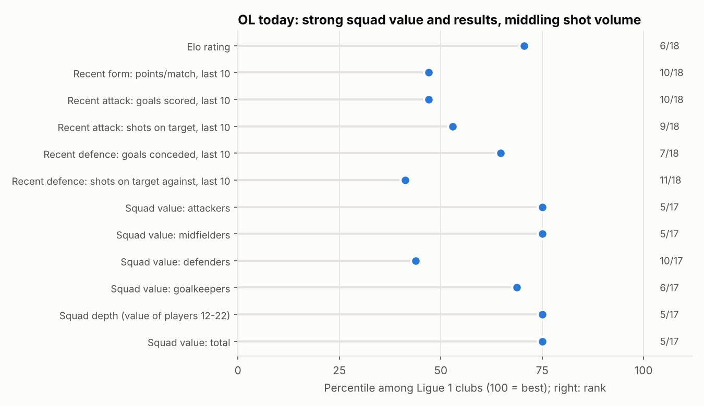
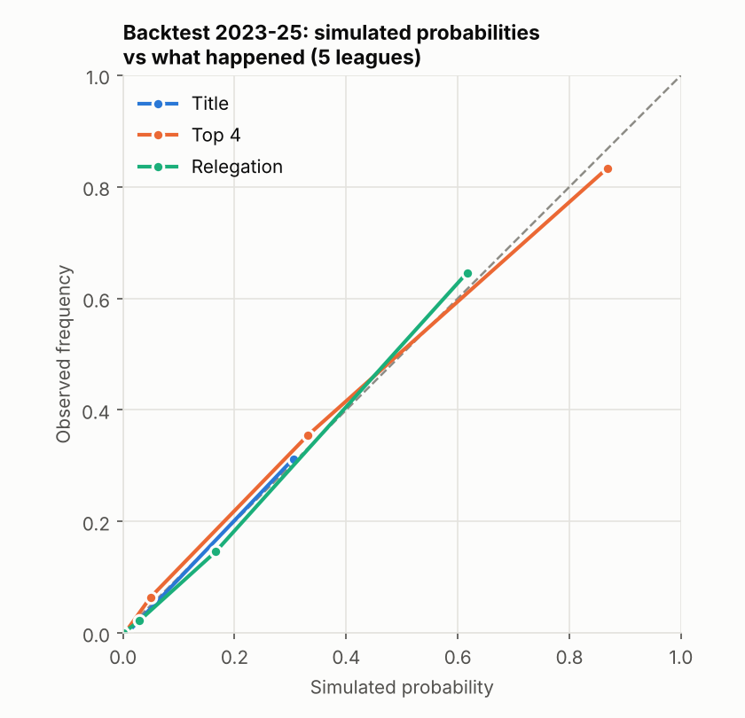

# Abstract

I build and evaluate probabilistic forecasts of football match outcomes (home win / draw /
away win) for the five major European leagues (29,239 matches, 2010/11 – October 2026),
then apply them to Olympique Lyonnais (OL). Features are constructed strictly from information
available before each match, and checked by an automated leakage test. Models — Elo, Poisson,
logistic regression, random forest, gradient boosting, SVM, neural networks — are compared on a
walk-forward test (2023 → 2026, 5,602 matches) with confidence intervals from a block bootstrap.
The main findings are deliberately sober: (i) almost all predictable information is long-run team
strength (Elo and squad market value); (ii) a regularised logistic regression is statistically
indistinguishable from boosting and neural networks; (iii) the models are well calibrated; (iv) the
bookmaker is better (log loss 0.966 vs 0.979), and mixing the models into the market's probabilities
adds nothing; (v) updating model weights as results arrive brings no measurable gain. A Monte Carlo
season simulator, backtested on 2023–2025, projects OL to finish with 57.6 points on average
(80 % interval 49–66), a 50 % chance of the top four and 4 % of the title.

# 1. Introduction

Football is the sport where the gap between a simple forecast and the best one is smallest: a
match is decided by a handful of goals, the stronger team wins only about half of the time, and one
game in four is drawn. This makes it a good laboratory for a question that matters in quantitative
finance as well: *how much can a statistical model extract from public data, how reliably can that
be measured, and does it survive comparison with a liquid market?*

The project is organised as a research study rather than a model-building exercise. Three principles
guided it: (1) **no leakage** — a feature used to predict a match on date *T* may contain nothing
dated *T* or later; (2) **temporal validation** — models are trained on the past and judged on the
future, never on random splits; (3) **honest evidence** — every claimed improvement is accompanied by a
confidence interval, and negative results are reported as such.

# 2. Research question

> *Can machine learning predict the future sporting performance of Olympique Lyonnais using
> team-level, match-level and contextual data — and does it beat simple references (Elo, the betting market)?*

The first formulation I considered — "feed player data to a neural network to predict OL's ranking" —
was rejected for statistical reasons: OL plays about 35 league matches a year (≈ 350 in ten years, far too
few to train anything), a final ranking is one observation per team and season, and neural networks
rarely beat simpler models on tabular data of this size. The question was therefore reformulated:
**train on all five leagues and treat OL as a case study.**

| Candidate target | Decision |
|---|---|
| Win / draw / loss probabilities of a match | **Main target** (≈ 29,000 observations) |
| Expected points | Derived: 3·P(win) + P(draw) |
| Final points, rank, Europe, relegation | Not trained (≈ 20 observations per league-season); obtained by **Monte Carlo simulation** of match probabilities |
| Individual player contribution | Dropped: a causal question, with too little data and strongly correlated players; replaced by an ablation of data categories |

# 3. Literature and existing approaches

*(References are given from memory and should be verified before formal citation.)*

**Rating systems.** Elo (1978) rates players from results; Hvattum and Arntzen (2010) adapt it to football
match prediction. **Goal models.** Maher (1982) and Dixon and Coles (1997) model goals with Poisson
distributions and attack/defence strengths — the origin of the "Poisson goals" baseline here. **Evaluation.**
Probabilistic forecasts should be judged by proper scoring rules (Brier, 1950; Gneiting and Raftery, 2007), and
for ordered outcomes by the ranked probability score (Constantinou and Fenton, 2012); I use log loss as the primary
metric together with Brier, RPS and calibration. **Markets.** Betting odds are strong forecasters (Forrest,
Goddard and Simmons, 2005; Spann and Skiera, 2009), and attempts to beat them with machine learning meet the
difficulty of the bookmaker margin (Hubáček, Šourek and Železný, 2019). **Tabular learning.** On medium-sized tabular
data, tree ensembles and simple linear models are hard to beat by deep networks (Grinsztajn et al., 2022). The
results below are consistent with all four strands.

# 4. Data

| Source | Content | Use |
|---|---|---|
| football-data.co.uk | Results, shots, shots on target, corners, cards, bookmaker odds; five leagues, 2010/11 → 2026 | Core |
| Transfermarkt dataset (dcaribou, CC0 on Kaggle) | 656,000 player market valuations | Squad value features |
| Self-computed | Elo ratings, shot-based "xG proxy" | Features |

**Volume.** 29,239 matches (OL: 593), 189 clubs. Training 2011–2020 (≈ 18,200 matches), validation 2021–22
(3,651), test 2023 → October 2026 (5,602).

**Sources examined and rejected.** FBref's advanced statistics were removed by its provider in January 2026.
Understat's `robots.txt` forbids automated access (`Disallow: /`), so real xG was not used. ClubElo was
unreachable from the build environment; Elo is computed from results instead. No clean, free, historical source exists for
injuries, line-ups or wages, so those could not be tested.

**Terms of use.** football-data.co.uk is free "for private individuals only, NOT commercial or data training
products using automated bots/scrapers/AI". This is a private, non-commercial study; the data are downloaded once,
kept out of the repository, and not redistributed — but the wording is ambiguous for a public machine-learning repository, a
point flagged in `docs/data_sources.md`. Details of every source (URL, period, variables, limits, biases) are in that file.

# 5. Data cleaning

Results are re-derived from the score and checked against the source's result field (zero disagreements);
duplicates are dropped; dates in mixed formats are parsed; matches are sorted chronologically and given a stable
identifier. Team names are consistent within each league (no alias table needed). The Transfermarkt data are
linked to football-data by matching **results** (competition, date and score, unambiguous matches only, majority vote):
176 of 189 clubs are matched with at least 24 supporting matches each and no duplicate identifiers. A name-similarity fallback
was tried and **rejected** because it mapped "Arles" to "RC Lens". The 13 unmatched clubs (outside the top flight in
Transfermarkt's coverage, or newly promoted) have no squad value. Known quirks: 2019/20 is truncated by COVID; Ligue 1 and the
Bundesliga have 18 clubs (306 matches); Pinnacle odds disappear in 2025/26, so Bet365 (complete throughout) is the market benchmark.

# 6. Feature engineering

All features are built from matches strictly before the one being predicted and are expressed for the home team,
the away team and their difference.

| Family | Construction |
|---|---|
| **Elo** | Home-made, per league: K = 20, home advantage 65, goal-difference multiplier, 25 % shrinkage toward the mean between seasons, promoted clubs start 75 points lower |
| **Recent form** | Rolling means over the last 3 / 5 / 10 matches of points, goals for and against, shots on target for and against |
| **Venue form** | Last 5 home (or away) matches |
| **League table** | Points and goal difference per match and normalised position before the match |
| **Schedule** | Rest days, matches in the previous 14 days (league only) |
| **Squad value** | Log total and top-11 market value relative to the league's average that month, from a monthly snapshot of valuations dated before the snapshot |
| **"xG proxy"** | See below |

**Preventing leakage.** (i) Every rolling feature is computed on the series shifted by one match. (ii) Fallbacks for
teams without history use the league mean over strictly earlier dates. (iii) Elo records the rating before the update. (iv) Standings are
taken before the day's matches. (v) Squad values use valuations dated strictly before the snapshot. (vi) Bookmaker odds are excluded from
the feature matrix. (vii) An **automated perturbation test** replaces every result from a cutoff date onward by random values, re-runs the entire pipeline
and requires that the features of all earlier matches — and of matches on the cutoff day, which tests independence from a match's own result —
be bit-for-bit identical. It was validated against two deliberately injected bugs (a rolling window without the shift; Elo recorded after
the update): it fails for both. A second test shows that the features computed for *future* fixtures reproduce the training features to machine
precision for any past date.

**Two lessons from the data.** First, the "xG proxy" — a regression of goals on shots — collapses to
**0.287 × shots on target** (the off-target coefficient is driven to zero), so it is not an independent signal and
is not real xG. Second, the variables counting how many matches a team has been observed for
(`n_prior`, `games_played_season`) are a **calendar clock** (mean 18 in 2010, 431 in 2026): a model can use them as a time trend and then
extrapolates outside the training range. Together with `sv_n` (a data-coverage count), they were removed from the **final
100-column feature set**; this cost +0.0011 log loss on validation (95 % CI −0.0008 to +0.0031, not significant).

# 7. Methodology

**Target and metrics.** The target is the three-class outcome. The primary metric is the **log loss** — a strictly proper
scoring rule that rewards honest probabilities — complemented by the Brier score, the ranked probability score, accuracy, macro-F1,
ROC-AUC, confusion matrix and calibration (reliability diagrams and expected calibration error). Accuracy is reported but
de-emphasised: draws are almost never the most probable outcome, so accuracy says little.

**Statistical significance.** Differences between models are tested with a **paired block bootstrap** on per-match log
loss, resampling whole calendar weeks (matches played the same week share context and are not independent), 4,000
draws, 95 % intervals. With ≈ 5,600 test matches the standard error of a log-loss difference is about 0.002–0.004, so
improvements below that cannot be detected.

**Tuning protocol.** Hyper-parameters are chosen only on the training seasons with time-ordered cross-validation
(`TimeSeriesSplit`): each fold trains on the past and scores the following block. Validation seasons are used for model
comparison during development; **the test seasons were used once**, for the final evaluation, with frozen hyper-parameters.

# 8. Models

| Family | Models |
|---|---|
| Baselines | Class frequencies; league table; Elo (calibrated to three classes by logistic regression); independent-Poisson goals |
| Linear | Multinomial logistic regression with L2 penalty (strength by time-ordered CV) |
| Trees | Random forest; gradient boosting (scikit-learn's histogram implementation, early stopping off because its built-in version holds out a random — temporally leaky — set) |
| Kernel | RBF support vector machine (small grid, compact feature set) |
| Neural | MLP with one hidden layer and deeper MLP with 2–3, regularised by L2, few epochs and averaging over five seeds |
| Online | Logistic regression whose weights are updated by gradient descent after each week of results, compared with a static model and a weekly refit |
| Reference | Bet365 prices converted to probabilities, margin removed proportionally (average margin 5.5 %) |

Only scikit-learn and numpy are used. scikit-learn has no Dropout or Batch Normalisation, so these are replaced
by L2 penalty, early epoch limits and seed averaging. **LSTM/GRU models were deliberately not built**: the rolling features
already summarise each team's history, and a recurrent network on about 20,000 rows would add variance without new information.

# 9. Validation

The data are temporal, so a random split would let the model learn from matches played after those it is
tested on and would also leak team-specific information through correlated neighbouring matches. The design is:

- **Training** 2011–2020 → **validation** 2021–22 (development, model comparison) → **test** 2023 → 2026 (touched once);
  the 2010 season is a warm-up for ratings and rolling features.
- **Final test: walk-forward.** Each test season *S* is predicted by models refit on all seasons 2011…*S*−1, as it would
  run in practice: models are re-estimated once a year while Elo and form update after every match.
- The 2020/21 season (empty stadiums) is flagged: the home advantage dropped that year.

# 10. Results

## 10.1 Development phases (validation 2021–22)

| Model | Log loss | Comment |
|---|---|---|
| Class frequencies | 1.0704 | Reference |
| League table | 1.0155 | Position is a noisy strength measure |
| Elo (+ logistic calibration) | 0.9962 | Strong and simple |
| Poisson goals | 0.9964 | Statistically equal to Elo |
| Logistic regression (106 features) | 0.9859 | −0.010 vs Elo (significant) |
| Random forest / boosting | 0.9894 / 0.9888 | Not better than logistic regression |
| SVM | 1.0098 | Under-tuned |
| MLP deep, 5 seeds | 0.9864 | Statistically tied with logistic regression |
| *Bookmaker* | *0.9781* | Better than all |

Hyper-parameter searches (random search, 12–20 configurations × 5 time folds) are documented in `reports/tables/`.
Boosting is penalised for complexity: the best models are shallow (depth 2), while the worst configuration tried reaches a CV log loss of
1.20. The best neural networks use very strong L2 regularisation and behave almost linearly.
A learning curve shows every model improving with data and none overtaking the logistic regression — at the full sample the non-linear
models remain 0.001–0.003 behind.

## 10.2 Final test, walk-forward 2023 → 2026

| Model | Accuracy | F1 macro | Log loss [95 % CI] | Brier | ECE | ROC-AUC |
|---|---|---|---|---|---|---|
| Baseline (frequencies) | 43.2 % | 0.201 | 1.0754 [1.069, 1.082] | 0.6509 | 0.012 | 0.494 |
| Elo | 52.5 % | 0.391 | 0.9888 [0.979, 0.999] | 0.5900 | 0.017 | 0.658 |
| Poisson goals | 52.0 % | 0.388 | 0.9902 [0.980, 1.001] | 0.5905 | 0.022 | 0.661 |
| **Logistic regression (final)** | 53.3 % | 0.399 | **0.9793** [0.969, 0.990] | 0.5834 | 0.016 | 0.669 |
| Gradient boosting | 53.0 % | 0.395 | 0.9787 [0.968, 0.989] | 0.5826 | 0.020 | 0.672 |
| Neural network (MLP, 5 seeds) | 53.0 % | 0.396 | 0.9796 [0.969, 0.990] | 0.5834 | 0.021 | 0.671 |
| Ensemble (LR + GB + MLP) | 53.0 % | 0.396 | 0.9779 [0.967, 0.988] | 0.5824 | 0.017 | 0.672 |
| *Bookmaker (Bet365)* | *54.0 %* | *0.405* | *0.9658* [0.955, 0.977] | *0.5740* | *0.022* | *0.686* |

{width=78%}

| Paired comparison (log loss) | Difference | 95 % CI | Significant |
|---|---|---|---|
| Logistic regression vs Elo | −0.0095 | [−0.0135, −0.0056] | yes |
| Boosting vs logistic regression | −0.0007 | [−0.0032, +0.0018] | no |
| Neural network vs logistic regression | +0.0003 | [−0.0016, +0.0022] | no |
| Ensemble vs logistic regression | −0.0014 | [−0.0027, −0.0001] | yes, barely |
| Logistic regression vs bookmaker | +0.0135 | [+0.0094, +0.0175] | yes (bookmaker better) |

The ranking is stable by season and by league; Ligue 1 is the hardest league for every model (log loss 0.995 vs 0.966–0.983 elsewhere).

## 10.3 Calibration and error structure

Probabilities are well calibrated (ECE 1.6–2.2 %). The model is almost never willing to name a draw as the most likely outcome
(6 of 5,602 matches; ROC-AUC for the draw class is 0.56), while home and away wins are discriminated moderately (AUC 0.72–0.73).

{width=88%}

## 10.4 Ablation: which data categories add value?

Logistic regression, nested blocks (validation, C re-selected each time):

| Model | Log loss | Δ vs previous [95 % CI] |
|---|---|---|
| A: Elo only | 0.9957 | – |
| B: + results form (3/5/10, venue) | 0.9931 | −0.0026 [−0.0051, −0.0001] |
| C: + shots and xG proxy | 0.9887 | −0.0044 [−0.0072, −0.0017] |
| D: + league table, fatigue | 0.9890 | +0.0003 [−0.0013, +0.0019] |
| E: + squad market value (final) | 0.9870 | −0.0020 [−0.0048, +0.0009] |

Results-based form and shots each add a small, detectable gain on top of Elo; league position and fatigue add nothing; squad value contributes
−0.002 which is not significant on two validation seasons even though it ranks second in the permutation analysis. The apparent contradiction is
redundancy: when a block is removed and the model refit, the others compensate (squad value and Elo both measure long-run strength). Injury and line-up
data, which could not be obtained, were not tested.

## 10.5 Finance extension: models versus the market

Question (purely academic): *can machine-learning probabilities outperform market-implied probabilities?* No betting
strategy is built or tested. Bet365 odds give an average margin of 5.5 %. I test whether the models add information
beyond the market by **log-linear pooling**, `p ∝ p_market^(1−w) · p_model^w`, choosing *w* on validation and applying it to the test seasons.

| Pooled model | w (from validation) | Pooled log loss | Market log loss | Δ vs market [95 % CI] | Best *w* on test (in-sample) |
|---|---|---|---|---|---|
| Logistic regression | 0.15 | 0.9663 | 0.9658 | +0.0005 [−0.0001, +0.0011] | **0.00** |
| Ensemble | 0.15 | 0.9664 | 0.9658 | +0.0006 [0.0000, +0.0011] | **0.00** |

The in-sample optimal weight on the model is **zero**: the market's probabilities already contain everything the models know, which is what
one expects of an informationally efficient market for public information. The models' realised log loss (0.9793) equals the entropy of their own forecasts (0.9791):
they are as uncertain as the data warrant. Between the naive 1.075 and the bookmaker's 0.966, the models recover about 87 % of the achievable
improvement; the remaining ≈ 0.013 is probably explained by what the market sees and we do not (line-ups, injuries, news).

# 11. Model interpretation

Permutation importance of feature *families* (shuffled jointly) on the validation seasons:

| Family | Logistic regression Δ log loss | Boosting Δ log loss |
|---|---|---|
| **Elo rating** | **+0.050** | +0.026 |
| **Squad market value** | **+0.024** | **+0.028** |
| Recent form | +0.007 | +0.001 |
| xG proxy / shots on target | +0.003 / +0.003 | +0.005 / +0.002 |
| Rest days, league table, venue form | ≈ 0 | ≈ 0 |

{width=80%}

**What explains results?** Long-run team strength, measured by Elo and squad value, accounts for almost everything the models can use; the home
advantage sits in the intercept (home sides win 44.7 % of matches, draw 25.2 %, lose 30.0 %). Recent form, shots and the xG proxy add a little;
rest, fatigue and league position add essentially nothing once strength is known.

{width=78%}

**Cautions.** The linear model assigns a *negative* net effect to recent form at fixed Elo and squad value — a collinearity artefact (form windows overlap each other, shots and
Elo), not evidence that hot streaks hurt; boosting finds none. Squad value is a proxy for club wealth and past quality, not a cause. The xG proxy's importance is that of shots
on target counted twice. Importances describe what the *models* use, not what causes results.

# 12. OL case study

{width=76%}

**Current strength.** OL is 3rd in Ligue 1 by Elo (1,615; Paris SG 1,707), 5th for recent points and goals scored, and 5th by squad value (€305 m;
attack and midfield 5th, defence 10th, goalkeepers 6th, depth 5th). Results and rating are better than the underlying shot volume
(10th for shots on target) would suggest.

**Match prediction — Paris SG – Lyon, 26 October 2026.**

| | OL win | Draw | OL loss | OL expected points |
|---|---|---|---|---|
| Model | 15 % | 21 % | 64 % | 0.67 |
| Bookmaker (margin removed) | 15 % | 20 % | 65 % | – |

The 90 % interval on OL's win probability is 14–17 % when only model uncertainty is considered (100 bootstrap refits) and 12–21 % once the uncertainty on
the teams' true strength is added (Elo ±60 points). The bookmaker and the model agree closely. For the 27 OL fixtures still to be played (opponents and venues known, order not), the
sum of expected points is 43.6, i.e. 57.6 points projected with the 14 already earned.

{width=76%}

On OL's 109 test-period matches the model's log loss is 0.982 (95 % CI 0.902–1.064) versus 0.953 for the bookmaker — consistent with the overall picture, but too few
matches to draw an OL-specific conclusion.

# 13. Monte Carlo season simulation

**Method.** 10,000 simulations of the rest of the season per league. In each, team ratings are shaken by N(0, 60) Elo points, every remaining match outcome is drawn from the
model's probabilities (recomputed exactly under the shock, since the logistic model is linear in the Elo inputs), a consistent scoreline is drawn from the Poisson goal model for tie-breaks,
and the table is ranked on points, goal difference and goals scored. The shock size σ was calibrated by a **backtest**: for every past season, the simulator was run from 31 October with
only what was then known and compared with the real final tables.

**Backtest, 2023–2025 (15 league-seasons, 288 team-seasons).**

| | Simulator | Naive reference |
|---|---|---|
| Mean absolute error of final points | **6.4** | 8.9 (current rate × games) |
| Brier score, title | **0.022** | 0.049 (base rate) |
| Brier score, top 4 | **0.064** | 0.165 |
| Brier score, relegation | **0.055** | 0.117 |
| Coverage of the "80 %" interval | 72 % | 80 % |

Simulated probabilities track observed frequencies, but the intervals are somewhat too narrow, so stated uncertainty should be read as a lower bound.

{width=48%}

**Ligue 1 2026/27 (state of 26 October, 7 matches played; assumed UEFA slots: Champions League top 3, Europe top 6, direct relegation bottom 2).**

| | Expected points [80 %] | Title | Champions League | Top 4 | Top 6 | Relegation |
|---|---|---|---|---|---|---|
| Paris SG | 71.9 [64–80] | 76.9 % | 96.2 % | 98.5 % | 99.7 % | 0.0 % |
| Monaco | 59.9 [51–69] | 7.2 % | 47.7 % | 62.3 % | 82.3 % | 0.0 % |
| Lille | 59.0 [50–68] | 5.7 % | 41.9 % | 56.6 % | 78.6 % | 0.0 % |
| **Lyon** | **57.6 [49–66]** | **4.0 %** | **35.7 %** | **50.4 %** | **74.5 %** | **< 0.1 %** |

{width=80%}

OL's most likely finishes are 2nd and 3rd (15–16 % each), but the distribution is wide: seven matches in, six clubs share 13–14 points, so the forecast rests on team strength rather than on the table.

# 14. Limitations

- **Information not available:** injuries, suspensions, line-ups, coaching changes, European fixtures, wages. The gap to the bookmaker is probably explained, at least in part, by these.
- **No real xG** (provider access removed or forbidden); the proxy is just shots on target.
- **Squad values** come from a crowd-sourced dataset whose pipeline stopped in July 2026: 2026/27 values are the June snapshot (summer transfers missing); 13 clubs have no value and are imputed.
- **Bookmaker benchmark** uses Bet365 pre-match prices (not the closing line) with proportional margin removal, a simple method.
- **Few validation windows:** two validation seasons and four test seasons (the last partial); the SVM was under-tuned; Elo hyper-parameters are conventional, not tuned.
- **No Dropout/BatchNorm** (library scope); online updating tested for the linear model only.
- **Simulation:** intervals too narrow in the backtest; UEFA slots and relegation rules are assumptions; head-to-head tie-breaks ignored; strength held constant apart from a random shock.
- **Data terms:** football-data.co.uk restricts use to private, non-commercial purposes; the raw data are therefore not redistributed.

# 15. Conclusion

On public data, football match outcomes can be forecast **well calibrated but only modestly sharper than team strength alone**. Elo and squad market value explain most of what is predictable; everything
else is worth about 0.009 log loss. A regularised logistic regression is as good as boosting and neural networks, which is the practical message: **complexity did not pay**. The models cannot beat
the betting market and carry no information the market lacks — a result consistent with market efficiency and with the interpretation that the unexplained part lies in information the models do not see. Updating weights
as results arrive adds nothing measurable beyond what Elo and rolling features already do. The study's value is therefore in the *method*: leakage-free construction verified by an automated test, temporal validation,
significance testing with block bootstrap, uncertainty at every level, and a simulator whose probabilities were checked against what actually happened. For OL, the model sees a top-five squad with results slightly ahead of its shot
volume, projecting about 57.6 points and a coin-flip chance of the top four.

# 16. Future research

1. **Add information the market has:** historical line-ups and injuries (e.g. from a licensed provider), true xG, and European fixtures for congestion.
2. **Better benchmarks:** closing odds and sharper margin removal (e.g. Shin's method); compare on the same snapshot of time as the model.
3. **Dynamic strength models** (state-space or Bayesian ratings) that give calibrated uncertainty on strength directly, rather than a calibrated shock.
4. **Ordinal and bivariate-Poisson models** with draw inflation (Dixon–Coles-type) to improve draw probabilities.
5. **Calendar-aware simulation:** actual fixture order, in-simulation updating of Elo and form, and fixture congestion.
6. **Other leagues and a longer window** to increase power for detecting small improvements, and a stricter pre-registration of the test protocol.

# Appendix — Reproducibility

`make pipeline` reproduces the data, features, OL predictions and simulations; `make all` reruns every experiment; `pytest` runs 18 tests including the leakage perturbation
test. The repository map, installation steps and per-phase reports (`docs/`) are in the README. All numbers in this report come from files in `reports/tables/`.
